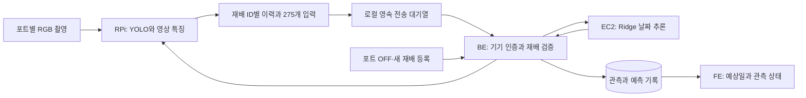
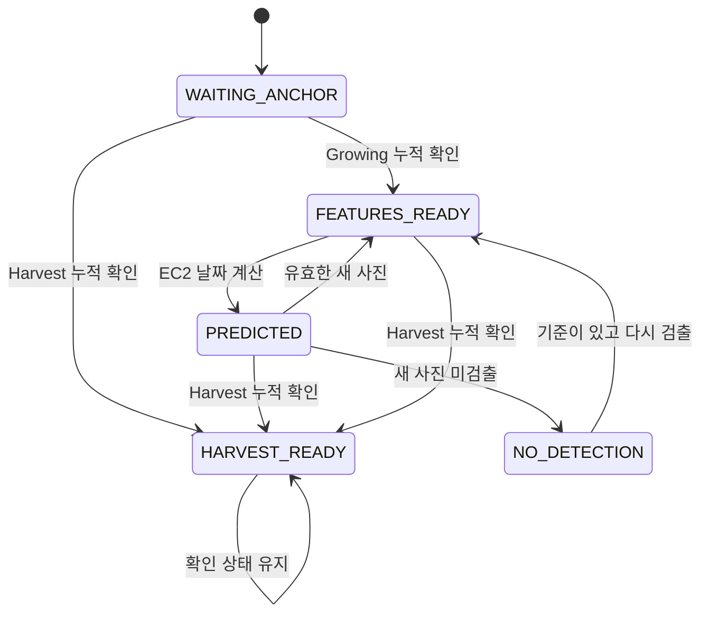

# GrowLab 예측 시스템 개발 기록

## v10 단계 도달일 예측에서 영상 기반 상추 수확기 도달일 예측까지

> 문서 작성: **2026-10-20**  
> 실험 결과 기준: **2026-10-19까지 저장된 검증 산출물**  
> 목적: GitHub 기술 문서 및 포트폴리오용 문제 해결 과정 정리  
> 범위: v10 전처리·학습, pH/EC 추가 비교, 딸기 이미지 분석, 상추 수확일 단일 예측, 외부 검증, 딥러닝 비교, 서비스 연동

이 문서는 모델이 최종적으로 어떤 숫자를 냈는지만 소개하지 않는다. **문제 정의가 왜 바뀌었고, 어떤 실험이 어떤 결정을 뒷받침했으며, 결과를 실제 서비스에 연결할 때 무엇을 구현했는지**를 기록한다. 채택하지 않은 방법과 미해결 문제도 함께 보존한다.

본문의 날짜 예측 성능은 대부분 외부 자료를 이용한 개발 검증이다. 실제 상품 수확 적기, 사람이 수확한 날, GrowLab 현장 정확도를 검증한 수치와는 구분한다. 운영 상태는 마지막으로 남은 확인 기록을 기준으로 하며, 문서 작성일에 운영 환경을 다시 조회했다는 뜻은 아니다.

---

## 빠르게 읽는 최종 결과

**최종 선택은 고정된 YOLO 영상 인코더와 성장 이력 275개 입력을 사용하는, 규제를 강화한 Ridge 수확기 잔여일 모델이다.**

| 항목 | 내용 |
|---|---|
| 최종 대상 | 상추 |
| 예측하는 사건 | YOLO가 Harvest를 누적 확인하는 시점 |
| 예측 시작 | Growing 누적 확인 이후 |
| 영상 처리 | 기존 YOLO의 생육단계 판독·대표 박스·중간층 영상 임베딩 |
| 입력 | 성장 이력 9 + 영상 임베딩 256 + RGB 통계 9 + 결측 표시 1 = **275개** |
| 날짜 모델 | 출처·환경·이력 균형 가중치를 적용한 표준화 Ridge, 정규화 규제 `lambda=10` |
| 최신 학습본 | AI-Hub·AeroGarden·UC Davis·LAB-Lettuce **139개 이력, 6,525개 관측 행** |
| 학습에 넣지 않은 Cornell 평가 | 선정된 13개 식물 위치·319개 예측 시점에서 **MAE 2.29일, RMSE 2.80일** |
| 같은 입력의 딥러닝 비교 | 작은 MLP도 실제 학습. Cornell MAE 3.52일로 Ridge보다 나빴음 |
| 분산 처리 | RPi에서 영상 분석·입력 준비, BE에서 검증·저장, EC2에서 날짜 추론, FE에서 표시 |

**Cornell 2.29일은 전체 성능을 대표하는 단일 보장값이 아니다.** 출처 전체 제외 검증에서 Ridge MAE는 약 3.36~5.04일이었고, 일부 출처의 최초 예측 MAE는 7~11일대로 컸다. 이 초기 오차와 수확기 판독 편차는 현재도 남아 있는 한계다.

기존 운영용 v2와 최신 LAB 추가 학습본도 구분한다. 최신 추가 학습본은 저장·검증을 완료했지만 이 기록 범위에서 운영 모델 교체까지 완료한 것은 아니다.

---

## 목차

1. [제품 문제와 개발 원칙](#product)
2. [전체 개발 흐름](#timeline)
3. [v10: 원본 식별과 과거 전용 전처리](#v10-preprocess)
4. [v10: 단계 도달일·성장률·위험 예측 결과](#v10-results)
5. [pH·EC/TDS 입력 제외와 재실험](#chemical)
6. [딸기 이미지 매핑과 v11~v13](#strawberry)
7. [상추 수확일 하나로 범위를 좁힌 이유](#scope)
8. [수확일 전환 이후의 계산식·LightGBM·상태 추적 실험](#early-harvest)
9. [박스 숫자에서 실제 영상 특징으로 확장](#visual)
10. [AI-Hub 원본 재판독과 275개 입력 통일](#unified)
11. [Planting과 Growing 기준 비교](#anchor)
12. [새 출처 LAB에서의 실패와 Ridge 규제 강화](#robust)
13. [LAB 추가 학습과 Cornell 신규 출처 검증](#cornell)
14. [동일 입력의 딥러닝 MLP 비교](#mlp)
15. [최종 275개 입력 명세](#features)
16. [최종 Ridge 학습·추론 수식](#ridge)
17. [RPi·BE·EC2·FE 서비스 구조](#architecture)
18. [운영 DB 보존과 이전 버전 호환](#migration)
19. [운영 모니터링 감사와 적용 상태](#operations)
20. [성능 해석과 아직 해결하지 못한 문제](#limitations)
21. [포트폴리오 관점의 설계 판단과 학습](#portfolio)
22. [재현 구조·모델 식별·근거 파일](#reproducibility)
23. [외부 자료와 문헌](#references)

---

<a id="product"></a>

## 1. 제품 문제와 개발 원칙

GrowLab은 RGB 카메라와 센서를 갖춘 재배 장치다. 초기 요구는 환경값을 보여주는 데서 나아가 생육단계 변화일, 수확일, 질병 발생 등을 미리 알려주는 것이었다.

예측 시스템의 조건은 모델이 필요로 하는 입력을 **실제 GrowLab에서도 지속적으로 생산할 수 있어야 한다**는 것이었다. 외부 논문이나 공개 데이터에 값이 존재한다는 이유만으로 CO₂, PPFD, 깊이 영상, 실제 생체중 등을 필수 입력으로 채택할 수는 없었다.

| 실제 사용할 수 있는 정보 | 사용 범위 |
|---|---|
| RGB 원본 사진 | 현재 발육 상태, 색·형태 특징, 현재 증상 관측 |
| 촬영시각과 재배 식물 ID | 같은 재배의 관측 연결, 과거 정보만 사용하는 입력 생성 |
| YOLO 단계·박스·신뢰도 | 영상 상태와 관측 크기 |
| 온습도·pH·TDS 등 기존 센서 | 환경 제어·이력·경고, 실험에서 효과를 확인한 경우의 예측 후보 |
| 사용자의 품종·등록·수확·고사 기록 | 재배 회차 구분과 서비스 맥락 |

PPFD/DLI, CO₂, 깊이 카메라, 잎 젖음, 포자량, 실제 무게 등은 현재 장치에서 자동 생산되는 공통 입력이 아니었다. 센서가 장치 전체에 공유되면 그것을 포트별 독립 측정값으로 설명하지 않았다.

개발 중 유지한 원칙은 다음과 같다.

1. **먼저 사건을 정의한다.** 사람 라벨 전환, YOLO 확인, 실제 수확, 화면 면적 변화는 다른 정답이다.
2. **원본을 유지한다.** 입력 선택과 원본 행 삭제를 구분하고 누락·미완료·판독 불가 사례를 기록한다.
3. **같은 표본에서 비교한다.** 방법마다 성공한 행만 골라 성능을 비교하지 않는다.
4. **단순 기준선을 강하게 둔다.** 평균 기간·경과일·현재 상태만으로 어디까지 맞는지 먼저 확인한다.
5. **새로운 출처를 별도로 본다.** 같은 재배 회차의 다른 식물 점수를 새 농장 성능으로 바꾸어 말하지 않는다.
6. **모델 학습과 운영 완료를 분리한다.** 모델 파일, 서버 연동, DB 변경, 실제 장치 교체는 각기 증거가 필요하다.

<a id="timeline"></a>

## 2. 전체 개발 흐름

단계 이름은 모델 패키지 버전, 데이터 전처리 버전, 실험 날짜가 섞여 있다. 특히 딸기 v11~v13은 상추 운영 v1/v2와 별개의 흐름이다.

| 시기 | 주요 작업 | 이후 판단에 남긴 것 |
|---|---|---|
| v10 정리, 2026-09 | 원본 JSON 식별·시각·단계 도달 정답·그룹 분할 재구성 | 사람 주석 기반 단계 도달일 예측의 기준과 한계 |
| 09-28 | 같은 분할에서 pH·EC 입력 추가 | 센서 기록 패턴과 실제 화학 측정 효과를 구분할 필요 |
| 10-01~10-02 | 딸기 원본 복구·전수 연결·v11~v13 사건 검수 | 사진 연결 완료와 성숙 사건 정답 확보는 별개 |
| 10-12 | GrowLab에서 생산 가능한 입력 중심 문헌 검토 | 영상 상태 추정과 날짜 예측을 분리하는 방향 |
| 10-14 | 과거 기록 감사, 계산식·유사 이력·LightGBM·상태 모델 비교 | 미래 정보·정답 소급·약한 기준선 문제 제거 |
| 10-16 | 원본 RGB 임베딩과 잎 개수 보조 회귀 | 박스 숫자보다 실제 영상의 발육 표현을 확장할 근거 |
| 10-18 | AI-Hub 원본 사진 판독, 동일 대표 박스, 275개 입력 | 사람 주석과 서비스 영상 입력 사이의 차이 축소 |
| 10-18~10-19 | Planting 시작과 출처 전체 제외 시험 | Growing 확인 이후를 최종 날짜 출력 시작점으로 선택 |
| 10-19 | 미사용 LAB 평가·Ridge 규제 강화 | 새 환경에서 약한 규제 모델의 편향 확인 및 개선 |
| 10-19 | LAB 추가 학습 후 Cornell 검증 | 고정 학습 규칙으로 신규 출처에서 재확인 |
| 10-19 | 동일 275개 입력 MLP 비교 | 이번 딥러닝 설정으로 Ridge를 대체할 근거 없음 |
| 10-18~10-19 | RPi·BE·EC2·FE 연동, DB 보존, 운영 화면 감사 | 실험과 서비스 사이의 입력 계약·생애주기·호환성 구현 |

이 과정에서 모델 종류만 바뀐 것은 아니다. **정답의 의미, 식물 식별 단위, 영상 측정 단위, 시간 처리, 학습 출처, 검증 질문**이 함께 정리됐다. 따라서 맨 처음 오차와 맨 마지막 오차의 차이를 하나의 순수 모델 개선율로 계산하지 않는다.

<a id="v10-preprocess"></a>

## 3. v10: 원본 식별과 과거 전용 전처리

### 3.1 자료의 실제 단위부터 복원

초기 v10은 AI-Hub 상추 JSON 42,122건과 딸기 JSON 152,043건을 사용했다. 합계 194,165건이다. 당시 날짜 모델은 실제 RGB 픽셀보다 **사람이 표시한 단계·박스·센서 기록**을 사용했다. 원본 사진을 확보해 영상 특징을 넣은 후속 실험과 구분해야 한다.

- `crops_id`는 항상 식물 한 포기의 ID가 아니었다. 베드·구역 정보와 포트 위치 토큰, 회차 정보를 함께 확인해야 했다.
- 같은 농장의 센서는 다수 포트 사진에 반복 연결되는 공통 스트림이었다. 센서값이 같은 사진을 합치는 처리와 포트별 식물 상태를 유지하는 처리는 목적이 달랐다.
- 긴 관측 공백이나 단계 되돌아감을 곧바로 새 정식 또는 실제 생육 역행으로 단정하지 않았다.
- `Planting`은 정식기다. 과거의 파종·발아 표현은 실제 원본 의미에 맞게 정정했다.

v7에서 42,122개 사진이 17,868행으로 줄었다는 사실만으로 대량 데이터 유실을 주장할 수 없었다. 당시 시간 키는 사진 촬영시각이 아닌 센서 수신시각이었다. 반면 같은 센서 키에 서로 다른 포트 단계가 붙는 충돌은 실제로 있었다. **집계 행 수 감소와 식물 신원 손실은 서로 다른 문제**였다.

### 3.2 시간 정보를 분리

| 시간 | 의미 | 사용 목적 |
|---|---|---|
| 사진 촬영시각 | 식물을 관측한 시각 | 영상 입력의 최신성·과거성 확인 |
| 센서 수신시각 | 환경 관측이 도착한 시각 | 예측 때 이용 가능한 측정인지 확인 |
| 예측시각 | 모델이 현재라고 간주하는 시점 | 입력의 시간 상한 |
| 사건 발생 구간 | 마지막 이전 단계와 첫 다음 단계 사이 | v10 단계 도달 정답 |
| `label_known_by` | 해당 정답을 알게 된 시각 | 시간순 학습 분할에서 미래 정답 유입 방지 |

예를 들어 오전에 시작된 관측이더라도 단계 전환을 다음날 알게 됐다면, 그 정답을 오전 cutoff 이전 학습에 넣지 않았다. 관측시각이 과거라는 이유만으로 정답도 과거에 알려졌다고 처리하지 않았다.

### 3.3 보간에서 발견한 미래 정보 문제

시계열 전체를 먼저 선형 보간한 뒤 시간 분할하면 뒤쪽 관측값이 과거 결측을 채울 수 있다. `limit_direction="forward"`라는 옵션 이름만으로 과거 정보만 사용한다고 보장되지 않았다.

```text
전체 자료:          [20, 결측, 결측, 26]
전체 구간 선형 보간: [20,   22,   24, 26]
26이 도착하기 전:   22와 24는 아직 알 수 없는 값
```

감사에서는 이러한 미래 끝점 사용 센서 셀을 46,834개 확인했다. 이는 최종 시험 전체가 그만큼 누수됐다는 직접 수치가 아니라, 기존 전처리에서 가능한 미래 참조 사례 수였다.

v10 이후의 공통 원칙은 예측시각 이전 관측만 연결하고, 허용된 과거값 유지와 결측 상태·관측 경과시간을 기록하는 것이다. 정규화·결측 처리의 학습도 각 training fold 안에서 수행했다.

### 3.4 당시 입력과 정답

상추는 정식기→생육기→수확기, 딸기는 정식기→출뢰기→개화기→과실비대기→수확기를 다뤘다. 목표는 **다음 관측 단계까지 남은 시간**이었다.

v10의 상추 단계 도달 정답은 관측 간격 때문에 구간으로 표현됐다. 주 MAE는 그 구간 중앙값과의 차이였다. 최종 YOLO 누적 확인 시각처럼 하나의 확정 타임스탬프를 정답으로 삼는 후속 모델과 정확히 같은 문제가 아니다.

딸기의 영상 크기는 잎·줄기까지 감싼 전체 외곽 대신 과실 박스 합집합으로 정리했다. 이것도 과실 무게나 실제 생물량이 아니라 **화면상 주석 면적**이었다.

전처리 검증 기록에서는 예측시각보다 미래인 사진·단계·센서 출처 0건, 정답 확정 이후의 부적절한 예측 연결 0건 등을 확인했고 회귀 검사 13개를 통과했다. 이러한 검사는 생물학적 정답의 정확성이나 GrowLab 일반화를 보장하는 검사는 아니다.

<a id="v10-results"></a>

## 4. v10: 단계 도달일·성장률·위험 예측 결과

### 4.1 기준선부터 구분

v10에는 상수 예측, 순수 산술 일정, 경과시간만 사용하는 학습 모델, 영상·센서 조합 모델이 함께 있었다.

**B2 경과시간 모델은 LightGBM으로 학습한 모델**이다. 평균 소요일에서 경과일을 빼는 순수 산술과 같지 않다. 어떤 기준선과 비교했는지에 따라 개선 해석이 달라졌다.

### 4.2 입력 조합

| 이름 | 개념 |
|---|---|
| A | 관측 단계·경과시간 |
| B | A + 현재 영상 박스 크기 |
| C | 현재 크기와 과거 영상 이력 |
| D | A + 온습도 |
| E | C + 온습도 |
| F_ph | pH 변화량을 포함한 추가 후보 |

여기서 영상은 당시 사람 주석 박스 기반 수치다. 최종 모델의 256차원 RGB 임베딩과 혼동하지 않는다. 작물·전환별 모델은 별도로 학습했으며 두 작물의 모든 단계를 하나의 가중치로 예측한 것은 아니다.

### 4.3 단계 도달일: 원수치 기준 비교

다음은 저장된 `compare_uniform_vs_arith.csv`의 농장 전체 제외 결과다. 단위는 MAE 일수, 원천 그룹 동일 비중이다.

| 작물·전환 | 순수 산술 | v10 LightGBM E | 불확실성을 포함한 원수치 판정 |
|---|---:|---:|---|
| 상추 정식기→생육기 | 2.28 | 2.03 | 차이 불확실 |
| 상추 생육기→수확기 | 2.39 | 1.83 | 평균은 감소했지만 순수 산술 대비 개선 구간은 0 포함 |
| 딸기 정식기→출뢰기 | 6.93 | 6.86 | 차이 불확실 |
| 딸기 출뢰기→개화기 | 13.26 | 14.59 | 평균은 악화, 차이 구간은 0 포함 |
| 딸기 개화기→과실비대기 | 10.07 | 8.24 | 개선 |
| 딸기 과실비대기→수확기 | 8.81 | 6.65 | 개선 |

상추 생육기→수확기의 농장 제외 평균 개선은 약 23.2%였지만, 순수 산술 대비 개선율 구간은 약 **-6.1~+47.2%**였다. 기존 요약문 일부의 확정적인 ‘개선’ 표현은 원수치보다 강했다.

동일 전환의 시간순 검증에서는 순수 산술 **2.70일**, E **2.93일**로 평균이 악화됐다. 반면 학습된 B2 경과시간 기준선과 비교하면 다른 개선율이 나온다. **약한 기준선을 이긴 결과를 모든 기준선에 대한 승리로 표현하지 않는 것**이 중요했다.

v10 당시 제품 판단은 산술 참고 일정을 표시하고 AI 결과를 별도 기록하는 것이었다. 이후 원본 RGB·외부 자료·새 정답 규칙 검증을 거치면서 현재의 수확일 서비스 구조로 판단이 바뀌었다. 당시 판단을 현재 최종안으로 인용하지 않는다.

### 4.4 검증 분할은 서로 다른 질문이다

| 분할 | 답하려는 질문 |
|---|---|
| 농장 전체 제외 | 학습에서 보지 않은 농장에도 통하는가? |
| 기존 그룹의 미래 | 과거에 관측한 환경에서 다음 시기를 맞히는가? |
| 새 그룹의 미래 | 새로운 그룹이면서 미래인 구간에도 통하는가? |

v10의 ‘새 그룹 미래’ 검증은 필요한 학습·시험 구성이 충분하지 않아 두 작물 모두 유효한 점수를 내지 못했다. 미평가를 성능 실패 수치나 일반화 성공으로 바꾸어 쓰지 않았다.

수경재배가 통제된 환경이어도 농장별 품종·빛·초기 크기·촬영·측정·라벨 기준이 같다는 보장은 없다. 농장 제외 검증은 이런 차이를 견디는지 확인하는 의미가 있다. 다만 실제 다음 재배 시점 성능까지 대신하지는 않는다.

### 4.5 성장률 예측과 날짜 예측은 구분

72시간·168시간 뒤 박스 면적 변화를 예측하는 실험도 있었다. 성장률의 로그 오차나 면적비 오차는 날짜 MAE가 아니다.

상추 72시간 성장률의 기존 새 농장 시험에서 GRU 0.261, 현재 유지 기준선 0.247 등의 결과가 있었다. 딸기 면적 변화는 일부 농장 분할에서 작은 개선이 있었지만 시간순 검증에서는 변화 없음 기준선보다 나빴다. 이를 ‘딥러닝 수확일 예측 정확도’로 소개하지 않는다.

일부 확장 입력은 행 평균에서 좋아도 배치 동일 비중에서는 이득이 불확실했다. 많은 사진을 가진 배치가 결과를 지배하는지에 따라 결론이 달라질 수 있다는 점을 확인했다.

### 4.6 질병·위험 예측 주장의 재검토

성장 둔화를 정상곡선과 모델 예측 차이로 정의한 대리 라벨 실험에서는 상수 모델이나 난수 대조군도 비슷한 AUC를 냈다. 상추 시간 검증의 한 기록에서 상수 0.75242, LightGBM 0.74397, 난수 0.73990이었다. 내부 라벨 생성 분할을 고쳐도 상수와 AI가 비슷했다.

따라서 해당 AUC는 실제 질병 발생을 미리 맞히는 능력의 근거로 채택하지 않았다. 현재 질병 검출, 병에 유리한 환경 노출, 미래 발병 날짜 예측은 각각 다른 기능이다.

### 4.7 LightGBM 발산을 원인까지 확인

이력별 균형 가중치를 그대로 주면 사진 1~2장뿐인 이력의 개별 행 가중치가 매우 커질 수 있었다. 한 L1 목적함수 실험에서는 일부 행이 리프의 가중 중앙값을 사실상 혼자 결정했고 예측이 학습 범위 밖으로 발산했다.

통제 실험에서 가중치 상한, L2/Huber 목적함수, 행 표본추출 설정 변화 등으로 발산이 사라지는 조건을 확인했다. 단순 출력 상한으로 이상값을 가리는 것과 학습 불안정 원인을 고치는 것을 구분했다. 후속 모델에서도 가중치와 규제의 영향은 중요한 설계 요소가 됐다.

### 4.8 시간 검증이 달라진 이유에 대한 반증 실험

농장 제외에서는 좋아 보이는데 시간순에서 이득이 작아지는 원인도 점검했다.

- 학습 전환 수를 줄이는 실험을 통해 단순히 학습량 차이만으로 농장 제외 개선을 설명하기 어렵다는 것을 확인했다.
- 학습·시험 온도 중앙값이 모두 약 22°C인 기록을 확인했다. 이를 계절 온도 하나만의 문제로 단정하지 않았다.
- 학습과 시험의 기간이 겹치는 작기를 제외하는 진단도 했지만, 같은 수를 무작위로 제외한 결과 범위 안이었고 평가 가능한 농장도 두 곳뿐이었다.
- 습도 분포 차이, 시간 분할의 작은 학습 사건 수, 농장과 촬영 시기의 의존성은 남았다.

따라서 시간 일반화 실패의 원인을 하나로 확정하지 않았다. 뒤의 외부 자료 검증은 이 문제를 새로운 출처·정답·영상 입력에서 다시 점검한 흐름이다.

<a id="chemical"></a>

## 5. pH·EC/TDS 입력 제외와 재실험

### 5.1 제외는 관측 행을 삭제한 것이 아니다

pH·EC가 있는 원본과 정답을 유지하고, 공통 날짜 모델의 입력으로 사용할지 비교했다. 원하는 점수에 맞춰 결과가 나쁜 식물을 빼는 것과는 다르다.

이 문제는 ‘화학 환경이 식물에 중요한가’와 ‘현재 여러 자료의 화학 측정값을 하나의 예측 입력으로 믿고 합칠 수 있는가’를 구분하는 문제였다.

### 5.2 기록 구조

| 확인 항목 | 결과 |
|---|---|
| 상추 정답 행의 24시간 pH/EC 변화 관측률 | 약 89.1% / 89.2% |
| 딸기 정답 행의 24시간 pH/EC 변화 관측률 | 약 29.2% / 33.4% |
| 딸기 화학 측정이 전혀 없는 농장 | 정답 행 기준 9개 중 4개 |
| 딸기 농장별 EC 현재값 중앙값 예 | 0.0725 대 0.8633, 약 11.9배 |
| 딸기 농장별 pH 현재값 중앙값 예 | 5.55 대 8.14 |

이 차이가 모두 오류라고 결론 내리지 않았다. 실제 관리 차이, 단위, 센서 교정, 기록 정책을 분리할 수 없다는 것이 문제였다. 센서 기록 유무만으로도 농장 유형을 구분할 수 있었다.

GrowLab의 TDS와 외부 EC는 단위·환산·교정 확인 없이 같은 열로 취급하지 않았다. TDS를 고정 상수로 나눈 값이 외부 농장의 EC와 동일한 의미라고 가정하지 않았다.

### 5.3 같은 실행 안에서의 민감도 비교

기본 E 36개 입력, 현재값 2개 추가, 측정값 없이 기록 경과·비율 6개만 추가, 전체 화학 특징 20개 추가를 비교했다. 같은 정답·분할·가중치로 동시에 재학습했다.

| 작물·전환 | 기본 E | 현재 pH·EC 추가 | 기록 경과·비율만 추가 | 화학 특징 전체 추가 |
|---|---:|---:|---:|---:|
| 상추 정식기→생육기 | 2.029 | 2.125 | 1.927 | 2.249 |
| 상추 생육기→수확기 | 1.787 | 1.915 | 1.784 | 2.143 |
| 딸기 정식기→출뢰기 | 6.840 | 6.797 | 6.303 | 6.588 |
| 딸기 출뢰기→개화기 | 15.200 | 13.126 | 13.287 | 13.247 |
| 딸기 개화기→과실비대기 | 8.172 | 5.990 | 6.171 | 6.050 |
| 딸기 과실비대기→수확기 | 6.638 | 6.485 | 6.264 | 6.555 |

단위는 MAE 일수, 농장 전체 제외다. 상추는 화학 특징 전체 추가 시 악화됐지만 딸기는 일부 단계에서 개선됐다. 특히 측정 수치 없이 기록 패턴만 넣어도 비슷하게 개선되는 구간이 있었다.

따라서 ‘pH·EC를 빼면 항상 정확하다’ 또는 ‘화학 값에는 정보가 없다’는 결론은 내리지 않았다. 현재 최종 날짜 입력에서 제외한 이유는 **일관된 공통 측정 계약과 새로운 출처에서의 추가 효과가 확보되지 않았기 때문**이다.

### 5.4 재현 한계도 함께 기록

이 재실험의 기본 E는 저장된 v10 예측을 행별로 정확하게 재현하지 못했다. 정답·표본은 같았지만 개별 예측이 달랐고 원인은 해결되지 않았다.

따라서 위 표는 **이번 재학습 실행 안에서의 입력 추가 비교**다. v10 공식 1.83일과 재실험 1.787일의 차이를 개선으로 계산하지 않는다. 이 표를 공식 v10 성능표로 대체하지 않았다.

<a id="strawberry"></a>

## 6. 딸기 이미지 매핑과 v11~v13

### 6.1 사진 확보와 연결 검증

원천 TAR 306개와 라벨 JSON 152,043개를 대조했다. 초기 0바이트 TAR 4개를 재다운로드한 뒤, 후속 v11에서 JPG 152,043장의 연결과 축소 디코딩을 전수 확인했다.

| 검사 | 결과 |
|---|---:|
| JSON–JPG 1:1 대응 | 152,043 / 152,043 |
| JPG 열기·축소 디코딩 | 152,043 / 152,043 성공 |
| JSON 내부 `fname`과 실제 JPG 이름 차이 | 16,854건 |
| 실제 이미지 크기와 JSON 크기 차이 | 192건 |
| v10 날짜 예측 행과 현재·과거 사진 연결 | 17,155 / 17,155 |
| 연결된 사진·단계·센서의 미래 출처 | 각각 0건 |

파일명 차이가 있는 경우 JSON 내부 `fname` 대신 라벨 파일명 줄기로 TAR 내부 JPG를 연결했다. 이름이 다르다는 이유로 다운로드 누락으로 세지 않았다. 전수 디코딩은 전수 사람 육안 검수와는 다르다.

### 6.2 사진이 생기면서 확인한 정답 문제

수확기 라벨 38,311건 중 5,943건, 약 15.5%에는 과실 박스가 없었다. v10 과실비대기→수확기 적격 시험행 4,044개 중 1,218개, 약 30.1%도 현재 과실 박스가 0개였다.

**주석 박스 0개가 사진 속 과실의 생물학적 부재를 뜻하지는 않는다.** 가림, 화각, 미주석을 구분할 수 없었다. 실제 사진에는 초록 과실과 붉은 과실이 섞이고 이웃 포트의 과실이 보이기도 했다.

### 6.3 전처리·단순 영상·긴 센서 이력 추가 결과

같은 v10 4→5 시험행과 분할로 비교했다.

| 방법 | 농장 제외 MAE | 시간순 MAE |
|---|---:|---:|
| v10 E 재학습 | 6.638 | 7.404 |
| 현재 사진 전체의 단순 RGB 요약 추가 | 6.625 | 7.409 |
| 과거 7·14일 온습도 요약 추가 | 7.153 | 7.329 |
| 박스 0개를 미검증 결측으로 처리 | 6.615 | 7.401 |
| 과실 박스 안 빨강 비율·주변 대비 추가 | 6.647 | 7.410 |

작은 차이를 안정적인 성능 향상으로 채택하지 않았다. 단순 빨강 비율은 분홍 재배 조명의 영향을 받았고, 긴 온습도 이력은 시간순에서 조금 좋아도 새로운 농장에서 악화됐다. 기본 E의 재현 문제는 이 비교에도 남아 있어 같은 실행 안의 비교로 한정했다.

### 6.4 v12: 기존 단계 라벨을 카메라 사건으로 이름만 바꿀 수 없었다

원본 클래스는 잎·줄기·화방·과실이었다. **꽃 한 송이·초록 과실·붉은 성숙 과실을 나누는 클래스는 없었다.** 일부 조사표의 개화 날짜도 사진에서 확인한 사건시각과 같지 않았다.

관측 구간에서 과실 박스는 0→양성 4,355회, 양성→0 4,236회로 나타났다. 이것은 과실이 생물학적으로 수천 번 생겼다 사라진 것이 아니라 주석 관측의 불안정성이다. 첫 박스 출현일을 착과일로 바로 사용하지 않았다.

원본 전환 전후 829장과 검토 시트를 만들고 대상 포트 귀속을 확인했다. 사진 전체의 붉은 물체를 중앙 포트의 성숙 사건으로 세면 이웃 식물의 정답이 섞일 수 있었다.

### 6.5 v13: 검수된 사건 구간은 얻었지만 날짜 모델 성능으로 만들지 않았다

실제 전후 사진에서 대상 포트 과실을 확인한 **국소 성숙 출현 구간 3개**를 기록했다. 독립 그룹 3개, 농장 2개이며 발생 구간 폭은 약 29.75·56.88·39.00시간이었다.

이는 검수한 구간 안의 첫 명확한 양성이지, 정식 후 생애 첫 성숙을 전 기간에서 입증한 사건은 아니었다. 검수자 1명이고 독립 이중 검수도 없었다. 이 3개 사건으로 모델 학습·독립 시험을 나누어 새 MAE를 발표하지 않았다.

결론적으로 **딸기 전처리가 미완료라 상추로 바꾼 것은 아니다.** 사진 연결은 완료됐지만 서비스가 예측해야 하는 성숙 사건 정답과 영상 판독기가 충분히 확보되지 않은 것이 핵심이었다. 최종 상추 275개 입력 모델이 딸기에도 그대로 검증됐다고 설명하지 않는다.

<a id="scope"></a>

## 7. 상추 수확일 하나로 범위를 좁힌 이유

모든 작물·모든 생육단계·질병·물 오염을 동시에 예측하려 하면 각 목표의 정답과 검증 단위가 달라 개발 판단이 흐려졌다. 상추를 먼저 선택하고 사용자에게 가장 직접적인 날짜인 수확기 도달일 하나를 출력하도록 정리했다.

문헌에서는 RGB로 현재 형태·발육 상태를 추정하고 성장 모델과 결합해 날짜를 예측하는 선례를 확인했다. 예를 들어 Nakano 등은 드론 RGB의 CNN 엽령 추정과 온도 기반 발육 모델을 결합했다. 해당 노지 결구상추 연구의 RMSE 2.35일을 GrowLab의 목표 성능이나 직접 비교 점수로 가져오지는 않았다. 입력·품종·수확 기준이 다르기 때문이다. [연구 원문](https://www.jstage.jst.go.jp/article/hortj/94/4/94_SZD-066/_html/-char/en)

문헌에서 가져온 것은 **영상으로 현재 상태를 갱신한 뒤 날짜 모델에 연결하는 구조**였다. 그 논문의 잎 수 기준, 온도 계수, 광 조건을 우리 박스 면적에 그대로 대입하지 않았다.

질병은 실제 최초 증상 사건, 포자량·잎 젖음 같은 필요한 입력이 없는 경우가 많았다. 환경 노출 경고를 미래 발병 확률·날짜로 표현하지 않았고, 현재 YOLO 질병 검출을 수확일 모델의 검증 결과와 합치지 않았다. 물 오염도 실제 오염 사건 정답 없이 pH/TDS 변화만으로 검증된 예측 기능이라고 주장하지 않았다.

### 최종 예측 계약

| 구분 | 최종 정의 |
|---|---|
| 예측 대상 | 현재 시점부터 YOLO Harvest 누적 확인 시점까지 남은 일수 |
| 예측 시작 | Growing 누적 확인 시점 |
| 예측 갱신 | 유효한 새 정기 촬영 관측이 들어올 때 |
| 예측 종료 | Harvest 누적 확인 시점 |
| 사용자에게 제공할 값 | 예상 수확 날짜와 남은 일수 |
| 날짜가 지났을 때 | 예측 날짜 경과만으로 Harvest를 확정하지 않음 |

`Planting`은 AI-Hub에서 **정식기**에 해당한다. 이를 씨앗을 심은 실제 파종일로 해석하지 않는다. Growing 기준 경과일 역시 파종 후 일수가 아닌 **Growing을 확인한 뒤 지난 시간**이다.

### Growing·Harvest 확인 규칙

- 최근 검출 관측 3개가 24시간 이내에 있어야 한다.
- 그중 2개 이상이 해당 단계이고 신뢰도 0.70 이상이면 확인한다.
- 조건을 충족한 현재 관측 시각을 확인 시각으로 저장한다. 나중에 사진이 더 들어왔다고 첫 양성 시각으로 소급하지 않는다.
- 정기 촬영 결과를 누적하는 방식이다. 확인을 위해 5초 간격으로 사진 3장을 새로 찍는 기능을 요구하지 않는다.

과거 일부 실험은 사람 단계 주석이나 다른 예측 진입 조건을 사용했다. 아래에 당시 조건을 구분했으며, 최종 규칙으로 정리된 실험의 성능과 섞어 평균하지 않았다.

<a id="early-harvest"></a>

## 8. 수확일 전환 이후의 계산식·LightGBM·상태 추적 실험

아래 실험들은 같은 날짜 문제를 향한 개발 과정이지만 예측 진입 조건·학습 자료·정답 생성 방식이 단계마다 달랐다. 각 표 안의 같은 조건 비교를 우선 해석한다.

### 실험 1. 초기 생육 계산식 + LightGBM 보정안 검토

초기에는 박스 크기를 실제 크기·무게로 환산하고, 성장 계산식의 잔여일을 LightGBM으로 보정하는 구현도 있었다. 기존 기록의 출처 평균 MAE 약 4.77일은 별도 재계산으로 재현됐다.

그러나 시험 출처의 실제 무게가 카메라 배율이나 목표 무게 계산에 들어가고, 일부 수확기 정답이 미래 관측을 사용해 소급 변경되는 문제가 확인됐다. 평가한 계산식과 최종 코드의 계산식도 같지 않았다. 따라서 이 점수를 **새 GrowLab에서 사진만 넣었을 때의 정확도**로 채택하지 않았다.

이 검토 이후에는 시험 식물의 미래 무게를 사용하지 않고, 관측 당시까지의 정보와 동일한 수확기 확인 규칙으로 평가하는 방향을 유지했다.

### 실험 2. 박스·경과일·성장속도로 과거 비슷한 이력을 찾는 방식

현재 박스 크기와 단계·경과일이 비슷한 과거 기록을 찾고, 최근 3일·7일 크기 변화율을 추가했을 때 남은 일수 예측이 개선되는지 시험했다.

| 시험 자료 | 경과일 산술 MAE | 현재 상태 참고 MAE | 성장 이력 추가 MAE |
|---|---:|---:|---:|
| UC Davis | 8.30일 | 6.23일 | 6.10일 |
| AeroGarden | 6.24일 | 5.76일 | 5.80일 |

이 실험 안에서는 성장속도 추가 효과가 작거나 악화됐고 절대 오차도 컸다. 해당 유사 이력 방식은 최종 날짜 모델로 선택하지 않았다. 이는 모든 성장속도 활용 방식이 불가능하다는 뜻은 아니다.

### 실험 3. AI-Hub와 외부 자료를 합친 LightGBM·센서 비교

AI-Hub 사람 단계·박스 주석을 외부 YOLO 관측과 합쳐 학습했다. 영상·이력 입력 18개, 온도를 추가한 27개, 온습도를 추가한 36개를 비교했다. 이 단계에서는 AI-Hub 원본 사진을 모두 YOLO로 재판독한 상태가 아니었다.

| 시험 출처 전체 제외 | 통합 산술 MAE | 영상·이력 LightGBM MAE | 영상·이력+온습도 LightGBM MAE |
|---|---:|---:|---:|
| UC Davis | 9.92일 | 10.30일 | 11.14일 |
| AeroGarden | 2.40일 | 6.37일 | 2.83일 |

온습도 추가는 AeroGarden에서는 개선됐지만 UC Davis에서는 악화됐다. AeroGarden에는 습도 관측이 없어 온습도 전체의 효용을 검증한 자료도 아니었다. 이 결과로 센서가 생육에 무의미하다고 결론 내리지 않았지만, 이 통합 LightGBM을 최종 모델로 선택할 근거는 얻지 못했다.

작은 학습 집합에서 트리가 분할되지 않아 상수 예측이 된 사례도 별도로 확인했다. 그 점수를 영상 AI의 성능으로 인용하지 않았다.

### 실험 4. 발육 진행도와 성장속도를 추적하는 상태 모델

박스·단계로 발육 진행도를 추정하고, 확장 칼만 필터로 진행도와 성장속도를 갱신한 뒤 수확기 도달일까지 적분하는 방식도 구현했다. Growing 이후 예측한다는 구조는 유지했다.

| 시험 출처 전체 제외 | 상태 모델 MAE | 같은 실험의 기간 기준선 MAE |
|---|---:|---:|
| UC Davis | 8.11일 | 9.30일 |
| AeroGarden | 2.78일 | 0.88일 |

출처에 따라 결과가 달랐고 UC Davis 오차가 컸다. 이 방식 역시 현재 최종 날짜 계산에는 사용하지 않는다.

<a id="visual"></a>

## 9. 박스 숫자에서 실제 영상 특징으로 확장

### 실험 5. 박스 숫자에서 실제 사진의 발육 정보로 입력 확장

박스 크기만으로 표현하기 어려운 잎의 형태·밀도·색·질감 정보를 사용하기 위해 **실제 RGB 사진을 고정된 YOLO 영상 인코더에 통과시켰다.** 이때 영상 임베딩 256개와 RGB 통계 9개를 추출했다.

초기에는 잎 개수 보조 추정도 함께 시험했다. IoT4Lettuce의 45포기·359장과 수동 잎 개수 자료를 사용했고, 같은 포기의 사진이 학습과 검증에 섞이지 않도록 분리했다. 잎 개수 MAE는 박스만 사용할 때 1.97개, 실제 RGB를 추가했을 때 1.46개였다. 이는 잎을 하나씩 YOLO로 탐지한 결과가 아닌 **사진 기반 개수 회귀 추정**이며, 해당 온실 조건의 결과다.

같은 날짜 모델·같은 시험 시점 안에서 실제 영상과 잎 개수 추정을 추가한 비교는 다음과 같았다.

| 시험 출처 | 박스·단계·시간 이력 MAE | 실제 영상·잎 개수 추정 추가 MAE |
|---|---:|---:|
| UC Davis | 3.74일 | 2.59일 |
| AeroGarden | 3.33일 | 3.10일 |

실제 사진 정보를 확장할 근거는 얻었지만, 영상과 잎 개수 추정을 함께 추가한 실험이므로 각각의 기여는 분리되지 않았다. 이후 최종 275개 입력에서는 **별도 잎 개수 추정값은 제외하고 영상 임베딩을 직접 사용**했다.

앞선 8.11일과 이 단계의 2.59일은 학습 자료·평가 시점·모델 구조가 달라, 차이 전체를 영상 추가의 효과로 계산하지 않는다.

### 실제 서비스 사진과 연결한 이유

모니터링에 원본 사진·전체 검출 JSON·대표 박스 인덱스가 이미 저장되고 있었다. 별도 센서를 추가하기보다 이 사진을 재사용해 실제 RGB 픽셀을 신경망에 통과시키는 입력을 만들었다.

기존 검출 개수는 잎 개수가 아니다. 잎과 전체 식물 박스가 섞일 수 있으므로 검출 수를 그대로 잎 수로 사용하지 않았다. 별도 잎 개수 회귀도 현재 조명·가림·촬영 조건을 바꾸면 성능이 달라질 수 있어 최종 필수 입력으로 유지하지 않았다.

여기서 핵심 변화는 단순한 박스 변화율 열 추가가 아니라 **식물 영역의 실제 영상 표현을 날짜 모델이 사용할 수 있게 한 것**이었다.

<a id="unified"></a>

## 10. AI-Hub 원본 재판독과 275개 입력 통일

### 실험 6. AI-Hub 원본 사진까지 포함한 275개 입력 통일

AI-Hub 원본 사진을 기존 식별 전처리에 연결하고 실제 YOLO로 판독했다. 단계·박스 크기·잘라낸 영상 특징이 **같은 대표 식물**에서 나오도록 맞췄다. 공식 Training/Validation 파일 구분만으로 독립 이력을 나누지 않았고, 서로 이어진 이력과 중복 파일을 고려했다.

이 단계의 Growing 학습 자료는 AI-Hub 73개, AeroGarden 1개, UC Davis 18개로 **92개 이력·4,595개 행**이었다. 기존 Ridge `alpha=100`의 개발 검증 결과는 다음과 같다.

| 자료 | 당시 검증 조건 | MAE | RMSE |
|---|---|---:|---:|
| AI-Hub | 농장 하나씩 전체 제외 | 3.28일 | 4.10일 |
| AeroGarden | 촬영 장면 전체 제외 | 2.14일 | 2.53일 |
| UC Davis | 같은 재배 회차의 다른 줄 식물 제외 | 2.13일 | 2.64일 |
| UC Davis | 출처 전체를 학습에서 제외 | 7.62일 | 8.07일 |

UC Davis의 2.13일은 같은 재배 회차의 다른 식물을 학습에 사용한 결과다. 처음 보는 재배 환경 성능으로 설명할 수 없다. **자료 안에서 잘 맞는 것과 새로운 출처에서 잘 맞는 것을 구분하게 된 단계**다.

### 10.1 원본 파일과 식별 문제

원천 TAR 85개, 사진 멤버 42,122개를 조사했고 중복 이름을 제거하면 41,622개였다. 기존 식별 규칙을 적용해 실제 40,677장을 YOLO로 판독했다. 원본 디코딩 오류는 0장이었다.

- 원천 TAR 두 묶음의 사진 500장은 이름·내용이 중복돼 있었다.
- 라벨 JSON 500개에는 대응하는 원본 사진이 없었다. TAR 번호가 같다고 라벨과 원천을 붙이지 않았다.
- 공식 Training과 Validation 양쪽에 158개 관측 문맥이 이어져 있었다. 폴더 이름만으로 식물 독립 분할을 가정하지 않았다.
- 실제 이미지와 JSON 크기가 다른 경우 실제 픽셀 크기를 사용했다.
- 완료되지 않은 이력을 예측 실패 또는 성공 사례로 임의 변환하지 않았다.

### 10.2 단계·크기·영상 영역이 같은 식물이어야 한다

기존 구현에서는 단계는 최고 신뢰도 박스에서, 크기는 최대 면적 박스에서 나올 수 있었다. 여러 식물이 보이는 사진에서는 서로 다른 객체의 단계와 크기가 한 입력으로 섞일 수 있다.

후속 규칙은 **최대 면적 대표 박스 한 개의 클래스·신뢰도·크기·crop**을 일치시키는 것이다. 이 수정은 점수가 좋아져서가 아니라 입력이 가리키는 객체를 맞추기 위해 필요했다.

다만 최대 면적 박스가 언제나 의도한 포트라는 보장은 없다. 고정 ROI와 재배 ID 관리, 주변 포트 혼입 점검이 여전히 필요하다.

### 10.3 모든 자료를 합치면 자동으로 좋아지지는 않았다

AI-Hub만 이용한 동일 대표 박스 농장 제외 시험에서는 기간 평균 MAE 3.09일, 박스·단계 회귀 3.14일, 실제 RGB 추가 회귀 3.25일이었다. 영상 추가가 모든 출처·분할에서 산술보다 우수하다는 근거는 없었다.

이후 목표를 모든 기준선에서 항상 이기는 모델이 아니라 **다양한 상추 출처에서 쓸 만한 오차를 유지하며 새 사진으로 갱신하는 공통 시스템**으로 명확히 했다. 이 판단 수정은 점수나 정답을 바꾼 것이 아니다.

그 과정에서 제안했던 출처별 MAE 4일·RMSE 5일·첫 예측 MAE 5일 기준은 공인 농업 기준이 아닌 제품 수용 기준안이었다. 최종 결과가 그 기준을 모두 충족했다고 주장하지 않는다.

<a id="anchor"></a>

## 11. Planting과 Growing 기준 비교

### 실험 7. Planting부터 예측하는 모델을 별도 시험

정식기 최초 관측을 기준으로 경과일·상대 크기를 다시 계산하고 같은 275개 입력으로 학습했다. 이용 가능한 이력은 AI-Hub 63개, UC Davis 1개였고 AeroGarden에는 해당 초기 관측이 없었다.

AI-Hub의 농장 제외 검증에서는 MAE 3.02일이었지만, UC Davis에서는 11.01일이었다. 이후 더 강한 출처 전체 제외 시험에서도 한 후보의 MAE가 AI-Hub 10.14일, UC Davis 10.52일이었다. LAB에서 기존 Planting 모델을 적용할 수 있었던 것은 4곳뿐이었고 MAE는 6.99일이었다.

따라서 **Planting 관측은 저장하되 날짜 출력은 Growing 확인 후 시작**하는 것으로 정했다. 이것은 생육기 전에는 수학적으로 예측할 수 없다는 뜻이 아니라, 현재 확보 자료에서 출처가 바뀌어도 견딜 만한 초기 예측 성능을 확보하지 못했다는 결정이다. 두 기준의 학습 집합도 다르므로 오차 차이를 기준일 하나만 바꾼 순수 효과로 해석하지 않는다.

### 예측 기준일과 사용자가 입력한 날짜는 다르다

사용자의 파종일·정식일은 재배 관리 기록으로 보존할 수 있다. 그러나 관측 시작부터 이미 자라 있는 외부 자료에서는 그 날짜를 영상 이력의 시작일로 복원할 수 없다. 최종 기준일은 **서비스와 학습에서 동일하게 재현할 수 있는 Growing 누적 확인 시각**이다.

### Growing 역시 첫날부터 정확도를 보장하지 않는다

Growing을 선택했다고 모든 출처의 첫 예측 오차가 낮아진 것은 아니다. 최종 비교에서 AI-Hub 출처 제외 최초 예측 MAE는 11.05일이었다. Growing 선택은 현 자료에서 상대적으로 검증 가능한 공통 시작점이라는 결정이며 완전한 초기 예측 해결을 뜻하지 않는다.

<a id="robust"></a>

## 12. 새 출처 LAB에서의 실패와 Ridge 규제 강화

### 실험 8. 처음 보는 LAB-Lettuce에서 기존 모델의 한계 확인

AI-Hub·AeroGarden·UC Davis로 학습한 고정 275개 입력 모델을 LAB-Lettuce에 적용했다. 당시 LAB은 학습에 쓰지 않았다.

- 72개 위치에서 Growing이 확인됐고, 관측 종료 전 Harvest가 확인된 47곳을 평가했다.
- 평가 행은 1,930개였다. 나머지 25곳은 도달 정답이 없는 미완료 사례로 보존했다.
- 기존 모델: **MAE 5.14일, RMSE 5.77일**.
- 같은 학습 자료의 평균 기간 산술: **MAE 3.55일, RMSE 4.30일**.

LAB에는 관수 중단 실험이 포함됐지만, 관수 중단 전 수확기 확인 25곳만 봐도 기존 모델 MAE가 6.41일로 좋지 않았다. 관수 중단만으로 전체 실패를 설명하지 않았다.

### 실험 9. 입력은 유지하고 Ridge 규제를 강화

새 자료에서 특정 입력에 과하게 의존하는 계수를 줄이기 위해, 기존 세 출처 전체 제외 검증에서 다음 후보를 비교했다.

- 기간 평균 산술.
- 성장 이력 9개 / 이력+RGB 통계 18개 / 전체 275개 입력.
- 남은 일수 직접 예측 / 전체 기간 예측 후 경과일 차감.
- 정규화 규제 강도 0.1 / 10 / 100.

선택 기준은 **기존 세 출처 중 가장 나쁜 출처의 MAE를 줄이는 것**이었다. 선택된 것은 전체 275개 입력·남은 일수 직접 예측·정규화 규제 `lambda=10`의 Ridge다. 세 출처 전체 재학습 시 실제 `alpha=45,950`이다.

같은 LAB 47개 위치에서 결과는 다음과 같았다.

| 방법 | MAE | RMSE |
|---|---:|---:|
| 기존 275개 입력 Ridge, alpha=100 | 5.14일 | 5.77일 |
| 규제 강화 Ridge | **3.36일** | **3.95일** |
| 평균 기간 산술 | 3.55일 | 4.30일 |

**영상 입력을 폐기하거나 LightGBM으로 돌아갈 필요 없이, 같은 입력의 학습 규제를 바꿔 LAB 오차를 줄일 수 있었다.** 다만 LAB의 최초 실패를 본 뒤 이 비교를 설계했으므로, 이 개선 수치를 처음부터 손대지 않은 LAB 최종 시험 성능이라고 부르지는 않는다. LAB 정답은 후보 순위를 계산하는 데 사용하지 않았다.

### 왜 최종적으로 선형 모델을 다시 선택했나?

v10에서도 Ridge를 시험했지만 당시 사람 단계·센서·박스 입력과 정답에서 좋지 않았다. 최종 Ridge는 실제 RGB 임베딩, 동일 대표 박스, Growing 기준, YOLO 확인 정답, 출처 균형 가중치와 강화된 규제를 사용한다. 이름이 같은 모델이라고 동일한 예측 문제는 아니다.

**‘v10의 Ridge는 나빴으니 이후 모든 Ridge도 나쁘다’거나 ‘Ridge를 쓰니 외부 환경이 해결됐다’는 해석은 둘 다 성립하지 않는다.** 지금 채택 근거는 현재 입력·현재 검증 규칙에서 얻은 결과다.

<a id="cornell"></a>

## 13. LAB 추가 학습과 Cornell 신규 출처 검증

### 실험 10. LAB 추가 학습과 Cornell 검증

### 13.1 최신 학습 자료

| 출처 | 재배/관측 이력 | 학습 행 | 해석 |
|---|---:|---:|---|
| AI-Hub | 73 | 3,982 | 5개 농장, 식별 전처리와 사진 연결을 통과한 이력 |
| AeroGarden | 1 | 59 | 한 촬영 장면의 시계열 |
| UC Davis | 18 | 554 | 한 재배 회차의 고정 식물 위치 |
| LAB-Lettuce | 47 | 1,930 | 수확기 확인까지 관측된 위치 |
| **합계** | **139** | **6,525** | 독립 작기 또는 독립 농장 139개가 아님 |

AI-Hub의 73개는 전처리로 구분한 관측 맥락이며, 모든 이력이 생물학적으로 동일한 한 포기임을 독립적으로 입증한 것은 아니다. 같은 식물의 반복 관측 6,525행을 서로 다른 식물 6,525포기로 설명하지 않는다.

AI-Hub에서는 적합한 사진 40,677장을 판독해 사건·입력을 만들었지만 그 사진 수가 곧 날짜 회귀 학습 행 수는 아니다. 대응 원본이 없는 JSON 500개와 완료 정답이 없는 이력은 별도로 보존했다.

IoT4Lettuce는 과거 잎 개수 보조 실험에 사용했지만 최종 139개 날짜 학습 이력에는 포함되지 않는다. HydroGrowNet·Wageningen·기타 보유 자료도 모두 검토 대상이었으나, 같은 식물의 연속 사진과 호환되는 수확기 사건이 확보되지 않은 자료를 날짜 정답으로 변환해 넣지 않았다.

### 13-A. 같은 관측에 대한 비교

Cornell의 선정된 내부 위치 16곳 모두에서 예측을 시작했다. 촬영 종료 전 Harvest가 확인된 **13곳의 동일한 319개 예측 시점**으로 비교했다.

| 방법 | 날짜 모델 학습 출처 | MAE | RMSE | 첫 예측 MAE |
|---|---|---:|---:|---:|
| 기존 v2 Ridge | AI-Hub + AeroGarden + UC Davis | 2.50일 | 3.00일 | 2.44일 |
| **최신 LAB 추가 Ridge** | 위 세 출처 + LAB-Lettuce | **2.29일** | **2.80일** | **2.35일** |
| 산술, 기존 자료 | 기존 세 출처 | 4.07일 | 4.57일 | 4.07일 |
| 산술, LAB 포함 | 동일한 네 출처 | 3.43일 | 3.82일 | 3.44일 |
| MLP 딥러닝 | 동일한 네 출처 | 3.52일 | 4.07일 | 4.06일 |

산술은 학습 자료에서만 구한 Growing→Harvest 가중 평균 기간에서 경과일을 뺀 방식이다. 기존 세 출처 기간은 13.9101일, LAB 포함 기간은 13.0249일이다. Cornell 정답으로 기간을 맞추지 않았다.

LAB 추가 Ridge는 13곳 중 11곳에서 MAE가 줄고 2곳에서 증가했다. 평균 감소는 **0.2133일, 약 5.12시간**이다. 큰 폭의 향상이라고 설명하지 않는다. 첫 예측 RMSE는 3.11→3.22일로 약간 증가했고, 녹색 블록 첫 예측 MAE도 3.37→3.68일로 증가했다. 모든 시점에서 개선된 것은 아니다.

### 13-B. 신규 자료의 범위와 미완료 사례

- 원본: [Cornell RGB and Depth Images](https://zenodo.org/records/14635169), CC BY 4.0. RGB 1,248장·Depth 1,248장 중 RGB를 사용했다.
- 파일명 날짜는 2024-03-13~03-28이며 실제 촬영일은 15일이다. 3월 19일은 누락됐다. 한 카메라·한 재배 회차다.
- 첫 사진으로 고정한 내부 위치 16곳, 각 80×80 영역을 사용했다. 주변부에서 잘린 식물은 처음부터 제외했다. 결과가 좋았던 식물만 사후 선택한 것은 아니지만, 전체 원본 식물의 성능은 아니다.
- 매 촬영일 원본 시계 08:00·14:00·20:00에 가장 가까운 사진을 ±60분 안에서 선택했다. 원본 42장, 개체 관측 672개다. 누락일은 보간하지 않았다.
- 파일명 시간대는 확인되지 않아 일정한 오프셋을 적용해 시간 차이만 사용했다. 실제 현지 시간대를 확정하지 않았다.
- Growing 확인과 예측 시작은 16/16, Harvest 확인은 13/16이었다. 나머지 3곳은 촬영 종료까지 수확기 정답이 없는 **우측 검열 사례**다.
- 전체 예측 419개 중 319개만 오차 계산에 썼다. 미완료 3곳의 100개 예측도 결과 파일에 남겼다. 그 3곳을 맞힌 것으로 계산하지 않았다.
- 빨강·녹색 블록의 정확한 품종 위치표를 저자로부터 확인하지 못했으므로, 품종별 정확도라고 주장하지 않는다.

### 13.2 기존 출처 오차 증가 점검

LAB을 추가할 수 있는 나머지 출처로 다시 학습했을 때도 기존 출처 성능이 유지되는지 확인했다.

| 날짜 학습에서 완전히 제외한 출처 | 평가 이력 | LAB 추가 전 Ridge MAE | LAB을 추가할 수 있는 학습 구성의 Ridge MAE | 해당 RMSE |
|---|---:|---:|---:|---:|
| AI-Hub | 73 | 4.99일 | 5.04일 | 6.32일 |
| AeroGarden | 1 | 3.57일 | 3.41일 | 3.94일 |
| UC Davis | 18 | 4.72일 | 3.70일 | 4.21일 |
| LAB-Lettuce | 47 | 3.36일 | 3.36일 | 3.95일 |

**행마다 제외한 출처와 학습한 모델 계수가 다르다.** 최종 네 출처 전체 학습본 하나가 학습에 쓴 각 출처를 독립 검증한 수치가 아니다. LAB 제외 행에서는 두 경우 모두 원래 세 출처로 학습하므로 값이 같다.

UC Davis는 개선됐지만 AI-Hub는 약 0.05일 악화됐다. 기존 세 출처 중 최악 MAE는 4.99→5.04일로 소폭 증가했으므로 최악 출처까지 개선했다고 말하지 않는다.

### 13.3 외부 자료의 양과 새로운 환경의 수는 다르다

Cornell은 한 카메라·한 회차, LAB은 한 시설 안의 위치들, UC Davis는 한 회차의 18개 위치다. 여러 식물과 수천 개 예측 행이 있다고 같은 수의 독립 농장·작기를 검증한 것은 아니다.

최신 모델은 139개 이력을 학습했지만 이는 같은 정도로 독립인 139개 재배 실험을 뜻하지 않는다. 반복 관측을 많이 추가하는 것과 다양한 재배 회차를 추가하는 것은 다른 데이터 증가다.

<a id="mlp"></a>

## 14. 동일 입력의 딥러닝 MLP 비교

### 실험 11. 동일 입력으로 딥러닝 MLP도 1회 비교

275개 입력·정답·평가 시점을 그대로 유지하고 날짜 계산부만 작은 다층 신경망으로 바꿨다.

- 구조: `275 → 64 → 16 → 1`, 은닉층 2개, ReLU, Dropout 0.2.
- 학습 매개변수: 18,721개. 기존 YOLO는 고정했다.
- AdamW, 학습률 0.001, weight decay 0.01, 최대 300 epoch, seed 42.
- 학습 집합 내부의 식물 약 20%를 통째로 분리해 종료 시점을 선택한 후, 허용된 전체 학습 자료로 다시 학습했다.
- Cornell 또는 출처 제외 시험 정답으로 설정을 바꾸지 않았다. 여러 구조·seed를 탐색해 최고만 고르지 않았다.

Cornell·LAB에서는 Ridge보다 나빴고 AeroGarden에서는 좋아졌다. UC Davis에서는 MAE가 줄었지만 RMSE와 첫 예측 오차가 증가했다. 따라서 이번 MLP로 운영 모델을 대체하지 않는다. 이는 **이번 신경망 설정의 결과**이며 모든 딥러닝이 불가능하다는 결론은 아니다.

### 14.1 같은 평가에서의 수치

| 검증 출처 | Ridge MAE | MLP MAE | Ridge RMSE | MLP RMSE |
|---|---:|---:|---:|---:|
| Cornell | **2.29일** | 3.52일 | **2.80일** | 4.07일 |
| AI-Hub | **5.04일** | 5.05일 | 6.32일 | **6.30일** |
| AeroGarden | 3.41일 | **1.81일** | 3.94일 | **2.04일** |
| UC Davis | 3.70일 | **3.37일** | **4.21일** | 5.14일 |
| LAB-Lettuce | **3.36일** | 4.85일 | **3.95일** | 5.51일 |

Cornell은 네 출처 전체 학습본의 고정 검증이고, 다른 네 행은 출처 제외 후 각각 재학습한 비교다. 같은 275개 입력에 날짜 계산부만 바꿨다. LSTM·Transformer나 영상 신경망 전체 재학습의 결과는 아니다.

### 최초 예측은 전체 시점 평균과 별도로 봐야 한다

| 검증 출처 | Ridge 첫 예측 MAE | MLP 첫 예측 MAE |
|---|---:|---:|
| Cornell | 2.35일 | 4.06일 |
| AI-Hub | 11.05일 | 8.96일 |
| AeroGarden | 7.76일 | 4.17일 |
| UC Davis | 2.52일 | 10.57일 |
| LAB-Lettuce | 2.15일 | 4.71일 |

새 출처의 Growing 직후 예측이 항상 3~5일 안으로 맞는다는 근거는 없다. 이후 관측까지 평균한 오차로 이 초기 한계를 가리지 않는다. AeroGarden의 결과는 한 이력에 대한 값이다.

### 14.2 왜 LSTM을 바로 넣지 않았나?

이번 질문은 기존 275개 입력과 정답을 유지하면서 날짜 모델만 딥러닝으로 바꾸면 나아지는가였다. 그래서 요약된 성장 이력을 받는 MLP를 사용했다. LSTM·TCN·Transformer처럼 원시 시퀀스 길이와 마스킹·샘플링까지 바꾸면 입력 표현 변화와 모델 변화가 섞인다.

MLP 내부 학습·검증은 같은 식물의 사진을 나누지 않고 식물 전체를 분리했다. 입력·정답 표준화는 내부 학습에서만 계산했고, 외부 출처 정답은 조기 종료에 쓰지 않았다. 네 출처 전체 모델은 내부에서 선택한 289 epoch만큼 전체 허용 자료로 재학습했다.

구조 1개·설정 1개·seed 1개를 비교했으므로 딥러닝 전반을 기각할 근거는 아니다. 기존 Ridge는 과거 비교를 거쳐 선택된 반면 MLP는 단일 설정이라는 탐색 예산 차이도 있다. Cornell의 이전 결과를 알고 시작했으므로 완전히 새로운 블라인드 시험도 아니다.

**이번 결과가 지지하는 결정은 현재 작은 MLP로 Ridge를 교체하지 않는 것**이다. 데이터 부족만이 원인이라고 확정하거나 더 큰 신경망이 반드시 해결한다고 추정하지 않는다.

<a id="features"></a>

## 15. 최종 275개 입력 명세

### 15-A. 입력 275개

| 구분 | 수 | 내용 |
|---|---:|---|
| 성장 이력 | 9 | Growing 확인 후 경과일, 로그 박스 면적·가로·세로, 현재 단계, Harvest 신뢰도, 기준 시점 대비 로그 면적 변화, 최근 3일 로그 면적 기울기, 사진 경과시간 |
| 영상 임베딩 | 256 | 대표 식물 영역을 기존 YOLO layer 10에 통과시켜 추출한 특징 벡터 |
| RGB 통계 | 9 | 녹색 비율, 녹색 강조값 평균·표준편차, 채도, 밝기, 흰색 비율, 암부 비율, 윤곽 강도, 식물 영역 crop 종횡비 |
| 영상 결측 표시 | 1 | 현재 정상 예측 경로에서는 실제 영상이 있으므로 0 |
| 합계 | **275** | 실제 사진의 발육 상태 + 동일 재배 이력의 시간 변화 |

박스는 영상 크기에 대한 비율로 정규화한다. 대표 식물은 가장 면적이 큰 박스로 선택하고, 주변 여유를 포함해 영상을 자른다. 화면 비율 정규화가 카메라 거리·각도·배율 차이까지 제거하는 것은 아니다.

영상 임베딩 각 차원에 잎 수·잎 길이처럼 명확한 이름이 붙어 있는 것은 아니다. 최종 입력에는 별도 잎 개수 추정값, 실제 무게, 깊이, 농장 ID, 출처 ID를 넣지 않는다.

### 15-B. 센서를 날짜 입력에서 제외한 이유

온습도 추가의 개선이 과거 출처별 비교에서 일관되지 않았다. pH·EC/TDS도 외부 자료마다 측정·단위·교정·누락 조건을 동일하게 확인하기 어려워, 현재 공통 날짜 모델의 필수 입력으로 사용하지 않았다.

이는 센서가 상추 생육에 영향을 주지 않는다는 뜻이 아니다. **현재 확보 자료와 검증 결과에서 영상·성장 이력을 공통 입력으로 선택한 것**이다. 센서는 환경 제어와 경고에 사용하며, 이번 Cornell 또는 MLP 실험에서 pH·EC의 독립 기여를 새로 검증한 것은 아니다.

### 15.1 배열 순서까지 고정한 입력 계약

| 0부터 시작한 위치 | 이름 | 의미 |
|---|---|---|
| 0 | `elapsed` | Growing 확인 후 경과일 |
| 1 | `log_area` | 대표 박스 화면 면적비의 로그 |
| 2 | `log_wr` | 대표 박스 가로 비율의 로그 |
| 3 | `log_hr` | 대표 박스 세로 비율의 로그 |
| 4 | `stage` | 현재 대표 박스 단계, 1·2·3 |
| 5 | `harvest_confidence` | 현재 대표 박스가 Harvest일 때 신뢰도, 아니면 0 |
| 6 | `log_relative_area` | Growing 기준 면적 대비 현재 면적비의 로그 |
| 7 | `area_slope_3d` | 과거 최대 3일의 로그 박스 면적 대 시간의 기울기 |
| 8 | `photo_age_hours` | 특징 계산 시각과 대표 사진 시각의 차이 |
| 9~264 | 영상 임베딩 256개 | 고정 YOLO 중간층의 식물 crop 표현 |
| 265~273 | RGB 통계 9개 | 아래 고정 순서 |
| 274 | 결측 플래그 | 현재 정상 경로는 0 |

RGB 통계 순서는 `green_fraction`, `excess_green_mean`, `excess_green_std`, `saturation_mean`, `brightness_mean`, `white_fraction`, `dark_fraction`, `edge_mean`, `roi_aspect`다.

기준 면적은 별도로 저장한다. 최근 이력은 최대 3일만 유지해도 상대 면적과 최근 기울기를 만들 수 있다. 기울기를 계산할 시점이 부족하면 현재 코드에서는 0을 사용한다. 신뢰할 수 있는 생리적 성장률을 새로 측정했다는 뜻은 아니다.

### 15.2 영상 표현 추출

1. 전체 입력 사진에서 성장 YOLO로 박스를 탐지한다.
2. 최대 면적 대표 박스를 선택한다.
3. 대표 박스 주변 10% 여유를 포함해 crop한다.
4. 고정 YOLO layer 10의 임베딩을 추출한다.
5. 같은 crop에서 RGB 통계 9개를 계산한다.

코드 계약은 성장 검출에 `imgsz=416`, `conf=0.25`, `iou=0.7`, 임베딩에 `imgsz=320`, `rect=False`를 사용한다. 누적 단계 확인의 신뢰도 0.70은 검출 후보 생성의 0.25와 다른 문턱이다.

영상 특징은 잎 수·엽면적·실제 무게의 직접 측정값이 아니다. 녹색 비율도 세그멘테이션 정답이 아닌 색상 대리지표다. 275개 중 일부가 고정되거나 서로 연관된 차원이므로 전부 독립적인 275개 생물학적 측정이라고 설명하지 않는다.

### 15.3 정적 메타데이터와 모델 입력의 구분

`plantId`, 장치·포트 식별, `capturedAt`, `observationId`, 모델 버전은 데이터 연결과 검증에 필수다. 그러나 농장·장치 ID를 날짜 모델의 설명변수로 넣는 것은 아니다. 식별자를 전달하는 것과 식별자를 학습하는 것은 다르다.

<a id="ridge"></a>

## 16. 최종 Ridge 학습·추론 수식

### 16.1 입력과 정답

관측 시점 `t`의 입력은 그때까지의 275개 값이고, 학습 정답은 `Harvest 확인시각 - t`의 일수다. Harvest가 끝내 관측되지 않은 이력의 정답을 임의 생성하지 않는다. 현재 모델은 검열을 직접 학습하는 생존분석 모델이 아니다.

### 16.2 균형 가중치

한 출처 안에서 환경, 한 환경 안에서 이력, 한 이력 안에서 관측 행에 비중을 나눴다.

```text
행 가중치 ∝ 1 / (해당 출처의 환경 수 × 해당 환경의 이력 수 × 해당 이력의 관측 수)
```

전체 행 가중치 평균이 1이 되도록 정규화한다. 긴 시계열 하나의 사진 수가 많다고 학습을 독점하지 않게 하기 위한 선택이다. 가중치는 현재 training fold에서 다시 계산한다.

### 16.3 학습 목적함수

학습 집합에서만 입력별 가중 평균과 표준편차를 구해 `z=(x-mean)/scale`로 표준화한다. Ridge는 다음을 최소화한다.

```text
Σᵢ wᵢ × (yᵢ - (b + zᵢ·β))² + α × Σⱼ βⱼ²
```

`β`는 학습하는 가중치, `b`는 절편이다. L2 규제가 큰 계수를 억제한다. 최신 공통 규칙은 `alpha = 10 × 학습 가중치 합`이다.

| 학습 집합 | 정규화 lambda | 실제 alpha |
|---|---:|---:|
| 기존 세 출처 4,595행 | 10 | 45,950 |
| LAB 포함 네 출처 6,525행 | 10 | 65,250 |

모델마다 alpha 숫자가 다르다고 Cornell을 보고 더 강하게 튜닝한 것은 아니다. 같은 정규화 규칙을 자료 수에 적용한 결과다.

### 16.4 추론

```text
remainingDays = max(0, ((features - mean) / scale) · coef + intercept)
expectedAt = predictedAt + remainingDays
```

입력 순서, 275개 유한 수치, 결측 표시 0, 사진 나이 0~6시간, 기준일과 경과일 일치, 모델·특징 버전을 확인한다. 음수 일수를 0으로 처리하는 것은 출력의 의미를 보존하는 처리이며 Harvest 확인과는 별개다.

기존에 학습된 YOLO가 시각 표현을 만들고 날짜 Ridge가 그 표현을 사용하므로 시스템 전체에는 딥러닝이 포함된다. **날짜 회귀 자체는 고전적인 선형 머신러닝**이다.

<a id="architecture"></a>

## 17. RPi·BE·EC2·FE 서비스 구조



### 17.1 RPi에서 처리하는 것

- 활성 포트를 확인하고 정기 촬영 한 장을 처리한다.
- 동일 대표 박스에서 단계·크기·영상 특징을 만든다.
- 재배 ID별 Growing 기준과 최근 이력을 로컬에 저장한다.
- 단계 누적 확인과 275개 입력 생성을 수행한다.
- 사진·관측 ID·입력 정보를 서버로 보낸다.

사용자가 늘어날 때 모든 사진의 전처리를 중앙 서버가 전부 맡는 대신 장치가 영상 처리를 분담한다. 날짜 모델은 중앙에서 관리해 모델 교체를 장치마다 반복하지 않게 한다. 다만 RPi CPU에서 PT 인코더를 실행하는 실제 처리시간·발열·촬영 주기 충족은 별도 현장 측정이 필요하다. 기존 NCNN 검출과 PT 임베딩이 자동으로 동일한 연산 비용이라는 주장은 하지 않는다.

### 17.2 상태 전이



그림은 예측 경로의 주요 상태를 요약한다. 실제 구현은 작물 미지원, 관측 대기, 포트 OFF 등의 조회 상태도 구분한다. Harvest가 확인되면 예상일이 도달한 것인지와 관계없이 확인 시각을 기록한다. 예상일 경과만으로 확인 상태로 바꾸지 않는다.

### 17.3 재배 ID와 포트 재사용

포트 번호는 재사용되는 위치다. 이전 식물의 사진과 새 식물의 사진을 포트 번호만으로 합치면 성장속도·기준일이 섞인다.

- OFF 또는 새 식물 등록을 서버 포트 상태로 동기화한다.
- 장치 이력의 키는 현재 `plantId`다.
- 종료된 재배의 전송 대기 사진을 새 재배에 붙이지 않는다.
- 서버도 활성 여부·장치·포트·재배 ID를 다시 확인한다.
- OFF 시 과거 날짜를 현재 식물의 예측처럼 노출하지 않는다.

서로 다른 품종의 환경 기준을 처리하는 제어 문제는 날짜 예측 모델과 별도다. 장치 공통 양액·공조 센서를 포트별 독립 제어·측정으로 설명하지 않는다.

### 17.4 오프라인·재전송·오류 처리

SQLite에 사진 작업과 식물 상태를 저장한다. 영상 추론과 업로드를 별도 루프로 실행해 네트워크 재시도가 다른 포트의 분석을 막지 않도록 했다.

- 같은 `observationId` 재시도는 이력을 중복 진행시키지 않는다.
- 순서가 뒤집힌 관측은 거부한다.
- 전송 전에 현재 포트·재배 ID를 재확인한다.
- 알 수 없거나 오래된 포트 상태에서는 전송을 멈추고 새 상태를 기다린다.
- 종료된 재배와 충돌하는 작업은 새 식물로 재배정하지 않는다.
- 입력 오류로 거부된 작업은 확인할 수 있도록 보존한다.
- 대기열에는 상한을 두고 가득 찼을 때 숨기지 않고 오류로 처리한다.

기기 인증키는 런타임 설정으로 제공하며 공개 패키지의 식물 상태·비밀키와 함께 배포하지 않는다. 외부 전송은 HTTPS를 요구하도록 구현했다.

### 17.5 BE와 EC2

BE는 기기가 보낸 버전·재배·시각·입력 모양을 검증한다. `FEATURES_READY` 상태의 기기는 스스로 계산한 날짜를 함께 보내지 않으며, 날짜는 EC2 응답으로 확정한다. 호환되는 이전 요청도 서버에서 다시 추론할 수 있다.

```text
GET  /api/device-edge/{serial}/ports      현재 포트·재배 상태
POST /api/photos                         사진·관측·특징 전달
POST /predict                            EC2 내부 예측 요청
GET  /api/harvest-predictions/{plantId}   사용자에게 해당 재배의 최신 결과 제공
```

이 경로는 코드의 API 계약 설명이다. 공개 서버 주소나 인증정보를 뜻하지 않는다.

### 17.6 FE에서 구분하는 정보

수확 예상일, 남은 일수, YOLO 관측 크기, 과거 대비 변화, 같은 품종·시기의 성장속도 비교를 각각 구분한다. 관측 그래프와 예측 날짜는 같은 기능이 아니다.

예측의 재배 ID가 현재 식물과 다르면 노출하지 않고, 오래된 관측은 별도 상태로 다룬다. 현재 코드의 조회·표시에는 8시간 이상 지난 관측을 오래된 결과로 표시하는 기준이 있다. 이것은 275개 입력 생성 시 허용 사진 나이 6시간과 다른 서비스 정책이다.

표시 문구·위치도 최종 수확일 하나를 중심으로 정리했다. 기존 단계별 참고 일정이 새로운 AI 예측처럼 보이지 않도록 분리하는 것이 필요했다. LLM 정밀 분석은 설명 기능이며 275개 날짜 입력이나 검증 정답 생성에 사용하지 않았다.

<a id="migration"></a>

## 18. 운영 DB 보존과 이전 버전 호환

### 18.1 로컬 개발과 운영 환경의 차이

로컬 개발에서는 스키마를 교체할 수 있어도 운영 DB에는 기존 사진·센서·재배 기록이 남아 있었다. AWS용 적용에서는 전체 테이블 재생성 대신 **추가형 마이그레이션**을 사용했다.

| 변경 | 목적 |
|---|---|
| `photo.plant_id` 추가 | 현재 재배와 사진 연결 |
| `photo.captured_at` 추가 | 서버 수신시각과 실제 관측시각 분리 |
| `photo.observation_id` 추가 | 재전송 중복 방지 |
| 관측 고유 인덱스 | 장치·관측 ID 조합의 중복 방지 |
| 재배·촬영시각 인덱스 | 식물별 과거 이력 조회 |
| `harvest_prediction` 새 테이블 | 상태·기준일·예측·버전·특징 저장 |

기존 사진의 새 컬럼은 nullable로 두었다. 포트·날짜가 비슷하다는 이유로 과거 행의 재배 ID와 촬영시각을 추정해 채우지 않았다. 기존 데이터 보존과 검증되지 않은 과거 연결 복원은 다른 문제다.

### 18.2 저장하는 예측 정보

예측 테이블은 재배·사진·장치·관측 ID, 촬영·예측·수신시각, 모델·특징 버전, 상태, 기준 종류·기준일, 남은 일수·예상일, 특징 JSON을 저장한다. 나중에 같은 시점의 예측을 재검증하고 모델 버전 차이를 추적하기 위한 구조다.

### 18.3 적용 전후 보존 확인

논리 백업과 gzip 무결성 확인 후 추가형 스키마를 적용했다. 당시 기록의 행 수는 다음과 같았다.

| 테이블 | 적용 전 | 적용 후 |
|---|---:|---:|
| photo | 788 | 788 |
| plant | 13 | 13 |
| 기존 prediction | 3,152 | 3,152 |
| 새 harvest_prediction | 없음 | 0 |

이 값은 특정 시점의 마이그레이션 확인 자료다. 현재 DB의 실시간 행 수가 아니다. 기존 행의 UPDATE/DELETE나 재배 ID 추정 연결은 하지 않았다. 논리 백업은 확보했지만 RDS 스냅샷까지 생성했다고 기록하지 않았다.

### 18.4 이전 모델 요청의 호환성

새 v2는 Growing 기준을 사용한다. 이전 v1 Growing·Planting 요청이 전송 대기열에 남을 수 있어 이전 모델을 보존하고 버전별 추론을 지원했다.

즉 `modelVersion`과 `featureVersion`은 표시용 이름이 아니라 입력·정답 의미를 함께 고정하는 계약이다. 새 계수 JSON 파일만 같은 이름으로 덮어쓰는 것이 모델 배포의 전부는 아니다.

<a id="operations"></a>

## 19. 운영 모니터링 감사와 적용 상태

### 19.1 모델이 있어도 날짜가 안 나오는 이유를 추적

운영 화면에서는 일부 포트에만 그래프가 있고 모든 포트가 비교 대기였으며, 수확일도 생성되지 않는 상황이 있었다. 이를 FE 렌더링 오류로 단정하지 않고 사진·재배·YOLO·예측 테이블·필터를 대조했다.

- 사진은 있어도 미검출·낮은 신뢰도·화면 잘림 때문에 유효 관측일이 적을 수 있었다.
- 성장속도 비교에는 같은 품종·같은 경과 구간의 유효한 다른 기록이 충분히 필요했다.
- 등록된 생육단계는 날짜 스케줄러나 과거 단일 YOLO 결과로 올라갈 수 있어, 현재 영상의 누적 확정 단계와 같지 않았다.
- 야간의 단일 Harvest 판정 하나가 기존 경로에서 등록 단계를 올린 사례를 확인했다. 다음 사진은 Growing이었다.
- 박스 중심 변화는 카메라·선택 객체 변화의 신호일 수 있지만 물리적으로 포트를 옮겼다는 증거는 아니었다.

당시 새 예측 테이블은 0행이었고 기존 사진의 신규 촬영·재배 식별 컬럼도 비어 있었다. **EC2 모델과 BE JAR만 바꿔도 구형 RPi가 새 입력 계약을 보내지 않으면 날짜가 생성되지 않는다**는 점이 확인됐다.

질병 양성 검출이 없던 시기도 있었지만 대부분 미검출인 기록을 ‘모든 식물 건강’으로 해석하지 않았다. 검출 없음과 정상 판독은 다르다.

### 19.2 완료 범위별 증거

| 구성 요소 | 마지막 확인 기록에서의 상태 |
|---|---|
| 기존 세 출처 v2 EC2 | 서비스 재시작, health 및 실제 predict 응답, 로컬·원격 파일 해시 일치 확인 |
| FE | AWS용 Git 반영과 Amplify 정적 결과 대조 기록 있음 |
| 운영 DB | 추가형 마이그레이션, 기존 행 수·인덱스·외래키 확인 기록 있음 |
| BE | AWS용 JAR 생성. 사용자 업로드 설명은 있으나 실행 JAR 빌드 해시를 독립 확정하지 못함 |
| 실제 RPi | 새 패키지·연동 코드 준비, 실제 기기 교체 완료는 미확인 |
| 최신 LAB 추가 Ridge | 로컬 학습·검증·저장 완료, EC2 운영 교체는 미실행 |
| 이번 MLP | 실험 산출물만 저장, 운영 미반영 |

이 표는 문서 작성일의 실시간 배포 점검 결과가 아니라 마지막 저장 기록의 범위다. ‘모델 구현 완료’, ‘일부 서버 반영’, ‘장치 포함 전체 운영 완료’를 하나의 완료 표현으로 합치지 않는다.

<a id="limitations"></a>

## 20. 성능 해석과 아직 해결하지 못한 문제

### 20.1 사진상 수확기 판독 자체의 한계

Cornell에는 사람이 기록한 실제 수확일 정답이 없다. 따라서 YOLO 누적 확인 시점을 목표로 사용했다. 그 뒤 확정된 13곳의 당시 사진과 미확정 3곳의 마지막 사진을 직접 확인했다.

- 적색 상추의 확정 사진은 잎과 포기가 발달해 수확 후보라는 판정이 육안으로 납득되는 모습이었다.
- 녹색 상추의 3월 22일 확정 사진은 포기는 형성됐지만 이후에도 더 자랐다. 목표 크기에 도달한 상품 수확 적기인지는 사진만으로 확인할 수 없었다.
- 3월 28일 확정된 녹색 상추는 더 발달해 보였다. 반면 미확정 녹색 상추 3곳도 일부 확정 개체와 비슷하게 자라 보였다.

이는 **정확한 수확 적기 시작일에 대한 전문 판정이나 수동 정답 부여가 아닌 육안 점검**이다. 실제 크기·무게·상품 기준이 없어 수확 적기를 확정하지 않았다. 이 점검 결과로 기존 정답이나 점수를 바꾸지도 않았다.

따라서 이번 검증은 어린 식물을 무조건 수확기로 처리한 실험이라고 보이지는 않지만, YOLO의 판독 기준이 이 자료에서 완전히 일관되다고 증명하지도 못한다. **날짜 모델 오차와 수확기 판독 자체의 정확도는 별개로 검증해야 한다.**

### 20.2 공통 성능 해석 원칙

1. **MAE는 백분율 오차율이 아니라 평균 절대 일수 오차**다. MAE 2.29일을 모든 예측이 ±2.29일 안에 맞는다는 뜻으로 설명하지 않는다.
2. 반복 사진 수가 많은 식물이 평가를 지배하지 않도록 식물/이력별 평균 절대 오차를 먼저 계산해 동일 비중으로 평균한다. RMSE는 이력별 평균 제곱 오차를 평균한 뒤 제곱근을 취한다.
3. 출처 제외 성능은 출처마다 다시 학습한 모델의 성능이다. 네 출처 전체 학습본을 같은 네 출처에서 독립 시험한 값이 아니다.
4. 날짜 학습에서 출처를 제외했어도 고정 YOLO의 원래 학습 자료 중복 가능성까지 제거한 종단 간 검증은 아니다.
5. 개발 중 결과를 확인하며 반복 설계했다. LAB 실패 뒤 규제 비교를 설계했고 Cornell 초기 5개 표본의 영상·단계도 전체 검증 규칙 고정 전에 확인했다. 완전한 사전 등록·비공개 최종 시험이라고 부르지 않는다.
6. 일부 자료는 한 재배 회차·한 촬영 장면뿐이며 미완료 이력은 날짜 회귀 평가에서 빠진다. 이를 다수 독립 농장 검증이나 모든 식물의 예측 성공률로 확대하지 않는다.
7. GrowLab 실재배의 날짜 정확도는 아직 별도로 측정하지 않았다. 모델을 고정한 뒤 각 시점에 저장한 예측과 이후 확인된 Harvest를 대조해 MAE·RMSE·첫 예측 오차·예측 가능 비율을 보고한다.

### 20.3 데이터가 더 필요하다는 말의 정확한 의미

현재 딥러닝을 실행할 수 없을 만큼 행 수가 0인 것은 아니다. 실제 MLP 학습도 완료했다. 부족한 것은 특정 장면의 반복 사진 장수만이 아니라 **다양한 재배 회차·촬영 조건·일관된 수확기 정답**이다.

같은 식물 사진을 촘촘하게 늘리면 성장 이력을 표현하는 데는 도움이 될 수 있지만 새로운 농장에 대한 독립 검증 환경 수를 늘리지는 못한다. YOLO 판독 편차가 정답에 남으면 복잡한 날짜 모델도 그 편차를 학습할 수 있다.

### 20.4 최종안은 ‘모든 조건에서 합격’이라는 뜻이 아니다

현재 선택은 확보 자료와 실행한 후보 사이에서의 구현 결정이다. 출처 제외 초기 예측과 일부 출처 평균이 제안한 제품 기준에 미달한다는 사실을 유지한다. 특정 새 자료에서 2일대 MAE가 나왔다는 이유로 전체 실패 가능성을 지우지 않는다.

해결할 다음 항목은 모델 이름 재탐색보다 다음에 가깝다.

- 일정한 촬영·식물 귀속과 판독 품질 확보.
- 수확기 판독의 사람 검수 및 상품 수확 기준과의 차이 기록.
- GrowLab의 완료된 새 재배 이력에서 사전에 저장한 예측 평가.
- 첫 예측·관측 누적 이후·수확 직전의 오차와 예측 제공 비율 분리.
- 새로운 재배 회차로 규제·보정의 효과를 평가하되 같은 회차를 독립 시험처럼 재사용하지 않기.

이 항목은 이번 문서 작성으로 새 실험을 수행했다는 뜻이 아니다.

<a id="portfolio"></a>

## 21. 포트폴리오 관점의 설계 판단과 학습

### 21.1 이 과정에서 해결한 문제

| 문제 | 수행한 판단·구현 | 확인 가능한 결과 |
|---|---|---|
| 목표가 단계·성장률·질병·수확으로 섞임 | 서비스가 재현할 수 있는 수확기 확인일로 범위 고정 | 단계별 날짜 대신 수확일 한 가지의 입력·정답 계약 |
| 같은 센서 키·다른 포트 혼합 | 원본 식별·재배 맥락·사진 연결 복원 | 원본 매핑표, 충돌·누락 목록 |
| 미래 보간·늦게 알려진 라벨 유입 | 과거 전용 입력과 `label_known_by` 기준 분할 | 접두 시점 검사와 시각 검증 기록 |
| pH·EC 제외 논리 불명확 | 같은 행·분할에서 실제값과 기록 패턴을 나눈 비교 | 개선·악화·재현 한계까지 공개한 ablation |
| 원본 단계명과 카메라 사건 불일치 | 딸기 사진 전수 연결과 사건 후보 검수 | 152,043쌍 연결, 검수 사건 3개와 미검수 구분 |
| 박스 숫자가 영상 상태를 충분히 표현하지 못함 | 고정 YOLO 임베딩·RGB 통계 도입 | 같은 조건에서 영상 추가 비교 |
| 새 출처에서 정확도 하락 | 출처 전체 제외·강한 규제·균형 가중치 | LAB MAE 5.14→3.36일, 별도 Cornell 확인 |
| 데이터 추가가 항상 개선이라는 가정 | 고정 규칙으로 LAB 추가 후 Cornell 비교 | 2.50→2.29일의 작은 개선 및 악화 위치 공개 |
| 복잡한 모델이면 낫다는 가정 | 동일 입력 MLP 단일 설정 비교 | 일부 개선과 다른 출처 악화를 함께 확인 |
| 운영 서비스에 모델 파일만 반영 | 재배 ID·관측 ID·버전·날짜 생성 권한 계약 | RPi·BE·EC2·FE 연동 코드 |
| 운영 DB 재생성 위험 | nullable 추가 컬럼과 새 테이블·인덱스 | 기존 행 수 보존 확인 |
| 화면 공백 원인 불명확 | 원본 사진부터 조회 필터·예측 테이블까지 추적 | 미검출·참조 부족·구형 입력 경로를 구분 |

### 21.2 가장 큰 배움

**모델 선택보다 먼저 맞아야 하는 것은 ‘무엇을, 누구에 대해, 언제 알 수 있었던 정보로 예측하는가’였다.**

- 센서·사진이 많아도 사건이 정의되지 않으면 날짜 학습 정답은 부족하다.
- 이미지 한 장의 모든 박스가 같은 식물의 정보는 아니다.
- 학습 데이터 안의 좋은 점수가 새 환경 성능을 설명하지 못한다.
- 원본 정보 보존과 서비스에서 사용할 공통 입력 선택은 별개다.
- 산술·상수 대조군이 모델의 추가 가치를 판단하는 데 필수였다.
- 모델 버전과 관측 생애주기를 코드·DB·화면이 함께 공유해야 했다.

### 21.3 포트폴리오에 사용할 수 있는 서술

> 상추·딸기의 단계 도달일 예측에서 출발해 원본 식별, 미래 정보 누수, 센서 기록 편향, 사람 주석과 영상 사건의 불일치를 분석했습니다. 최종적으로 GrowLab에서 생산 가능한 RGB와 포트별 성장 이력을 이용해 상추 수확기 도달일 하나를 예측하도록 문제를 재정의했습니다. 고정된 YOLO의 영상 임베딩과 성장 이력 275개를 사용하는 Ridge를 학습했고, 새로운 출처를 제외하는 검증과 동일 입력 딥러닝 비교로 모델을 선택했습니다. 네 외부 자료의 139개 이력을 학습한 모델은 미사용 Cornell의 선정된 13개 위치에서 YOLO 수확기 확인일 기준 MAE 2.29일을 기록했습니다. 이 수치를 현장 보장값으로 확대하지 않고 출처별·최초 예측 오차도 공개했습니다. 또한 장치에서 특징을 준비하고 EC2가 날짜를 계산하는 구조, 재배 ID 기반 이력 분리, 관측 중복 방지, 기존 행을 보존하는 DB 마이그레이션을 구현했습니다.

위 문장은 수행한 기술 작업의 요약이다. 이미 학습된 YOLO를 새로 설계·학습했다는 주장, 실제 수확 적기 2.29일 정확도 달성, 장치 포함 전체 운영 완료라는 주장은 포함하지 않는다.

### 21.4 면접에서 숫자를 물으면

| 질문 | 근거에 맞는 답변 |
|---|---|
| 정확도가 몇 %인가? | 날짜 회귀이므로 MAE·RMSE 일수로 답한다. 2.29일을 정확도 퍼센트로 바꾸지 않는다. |
| 새로운 곳에서도 2.29일인가? | Cornell 선정 위치의 결과다. 출처 제외 MAE는 약 3.36~5.04일이고 초기 오차는 더 클 수 있다. |
| 왜 LightGBM이 아닌가? | 과거에는 사용했지만 입력·목표를 정리한 현재 비교에서 강화된 Ridge를 선택했다. 모델 계열의 보편적 우열은 아니다. |
| 딥러닝이 아닌가? | YOLO는 딥러닝, 날짜 Ridge는 선형 머신러닝이다. 날짜 MLP도 같은 입력으로 시험했다. |
| 실제 수확일인가? | YOLO Harvest 누적 확인일이다. 작업자의 수확일·상품 수확 적기는 별도다. |
| 현장에서 검증했나? | 운영 사진·연동 감사는 했지만 완료 재배 회차의 현장 날짜 MAE는 아직 없다. |
| 왜 센서를 뺐나? | 현재 외부 자료의 공통 측정 계약과 추가 효과가 일관되지 않았다. 생물학적으로 불필요하다는 뜻은 아니다. |

<a id="reproducibility"></a>

## 22. 재현 구조·모델 식별·근거 파일

### 22.1 주요 구현 경로

아래 경로는 프로젝트 루트 기준이다. 원본 데이터와 운영 비밀정보를 포함하지 않고도 구조와 실험 근거를 추적할 수 있도록 상대 경로로 기록했다. 연구 산출물을 별도로 보관하는 저장소에서는 해당 파일을 함께 공개하거나 요약 표를 유지하면 된다.

```text
prediction_model/
  harvest_inference.py                  # EC2의 275개 입력 검증·Ridge 추론
  harvest_models/growing.json           # 기존 운영용 v2
  visual_growth/                       # 영상 특징·초기 날짜 회귀 연구 코드
  strawberry_training/                 # 딸기 매핑·품질·사건 생성 연구 코드

deployment/growlab_edge_20261018/growlab/
  edge_predictor.py                    # 누적 단계 확인·275개 입력
  edge_features.py                     # 대표 crop·RGB 통계
  edge_runtime.py                      # 재배별 상태·SQLite 작업 대기열·전송

GrowLab_BE/
  src/main/java/com/metaverse/growlab_be/harvest/
  src/main/java/com/metaverse/growlab_be/photo/
  database/migrations/20261018_edge_harvest.sql

Growlab_fe/src/utils/
  harvestPrediction.js                 # 재배 일치·남은 일수·오래된 결과 처리
  growthEvidence.js                    # 관측 추이·비교 가능성 처리

output/
  preprocess_v10/
  training_v10/
  strawberry_image_v11/
  strawberry_vision_v12/
  strawberry_vision_v13/
  lettuce_selective_retest_20261014/
  lettuce_pooled_transfer_20261014/
  harvest_state_model_20261014/
  monitoring_visual_trial_20261016/
  aihub_visual_validation_20261018/
  lettuce_final275_20261018/
  lab_lettuce_external_validation_20261019/
  open_data_extension_20261019/
  lettuce_mlp275_20261019/
```

### 22.2 모델 버전과 해시

| 구분 | 식별 |
|---|---|
| 기존 운영용 버전 | `lettuce-ridge275-robust-20261019-v2` |
| 특징 버전 | `selected-roi-rgb275-v1` |
| 최신 LAB 추가 학습본 | `output/open_data_extension_20261019/candidate_growing_plus_lab.json` |
| MLP 전체 학습본 | `output/lettuce_mlp275_20261019/models/all_four_sources.pt` |

```text
기존 v2 Growing SHA-256
03c74f31f51e07ebd3539e4a46b552404130303239271f0e0a828e1e530a6ab9

최신 LAB 추가 Ridge SHA-256
8323f845e35d583fc51a1a3314a2731e15b446564383f6c9d3ba09d2a4602798

고정 성장 YOLO SHA-256
c0a1163fb7a4603e00896a3cf9dff9ae9b942531c15fe76562a87254142f027a
```

최신 추가 학습본은 연구용 식별자로 저장됐다. 운영에 반영할 때에는 계수만 교체하지 않고 모델·특징 버전과 호환 요청을 함께 관리해야 한다.

### 22.3 실험별 근거 목록

| ID | 무엇을 확인할 수 있는가? | 대표 파일 |
|---|---|---|
| E01 | v10 식별·시간·입력 계약 | `output/preprocess_v10/REPORT.md`, `FINAL_VALIDATION.json` |
| E02 | v10 공식 단계 점수·산술 비교 | `output/training_v10/RESULTS.md`, `compare_uniform_vs_arith.csv` |
| E03 | pH/EC 민감도와 재현 한계 | `output/training_v10/ph_ec_ablation/REPORT.md`, `scores.csv` |
| E04 | 과거 결과·누수·강한 기준선 감사 | `output/prediction_feasibility_audit/REPORT.md` |
| E05 | 딸기 전수 매핑 | `output/strawberry_image_v11/REPORT.md` |
| E06 | 딸기 사건 라벨 진단·수동 구간 | `output/strawberry_vision_v12/REPORT.md`, `output/strawberry_vision_v13/REPORT.md` |
| E07 | 초기 계산식·LightGBM 재현과 문제 | `output/codex_review_claude_20261014/REVIEW.md` |
| E08 | 유사 이력 재시험 | `output/lettuce_selective_retest_20261014/DECISION.md`, `metrics.csv` |
| E09 | 통합 LightGBM·온습도 | `output/lettuce_pooled_transfer_20261014/REPORT.md`, `PROTOCOL.md` |
| E10 | 발육상태·칼만 필터 | `output/harvest_state_model_20261014/REPORT.md` |
| E11 | 실제 RGB·잎 개수 보조 비교 | `output/monitoring_visual_trial_20261016/README.md`, `harvest_metrics.csv`, `leaf_metrics.csv` |
| E12 | AI-Hub 원본과 동일 대표 박스 | `output/aihub_visual_validation_20261018/CONCLUSION.md`, `selected_roi/README.md` |
| E13 | 통합 275개 입력·기준일 비교 | `output/lettuce_final275_20261018/RESULTS_KO.md` |
| E14 | 최초 LAB 외부 검증 | `output/lab_lettuce_external_validation_20261019/REPORT_KO.md` |
| E15 | 규제 강화·Planting 제외 | `output/lab_lettuce_external_validation_20261019/ROBUST_SELECTION_KO.md`, `robust_fourth_source_test.csv` |
| E16 | LAB 추가·Cornell | `output/open_data_extension_20261019/validation_metrics.csv`, `source_regression_metrics.csv`, `training_audit.json`, `verification.json` |
| E17 | MLP 단일 설정 학습·비교 | `output/lettuce_mlp275_20261019/RESULTS_KO.md`, `protocol.json`, `metrics.csv`, `audit.json` |
| E18 | 운영 스키마·서버 반영 기록 | `output/deployment/DB_HARVEST_MIGRATION_20261019.md`, `EC2_HARVEST_V2_20261019.md` |
| E19 | 사진·모니터링 감사 | `output/port_photo_yolo_20261019/MONITORING_AUDIT_20261019.md` |

v10 종합 요약과 원수치 판정이 다르면 이 문서는 원수치와 후속 감사에 맞춰 해석했다. AI-Hub 초기 채택 판단은 후속 `LETTUCE_ACCEPTANCE.md`에서 수정됐으므로 이전 결론만 떼어 최종 결정으로 인용하지 않는다. 과거 보고서는 작성 시점의 사실과 판단을 남긴 기록이며 현재 결정과 다를 수 있다.

### 22.4 재현에 필요한 조건

- 원본 자료 접근 권한과 각 출처 파일 버전.
- 사진·JSON 대응 목록, 식별·중복·제외 규칙.
- 고정 YOLO 가중치 해시와 검증된 인코더 환경.
- 동일한 특징 순서·전처리·기준일·수확기 확인 규칙.
- training fold에서만 적합한 표준화·가중치·모델 설정.
- 시점별 예측 파일·완료/미완료 목록·출처별 점수.

현재 장치 인코더는 `ultralytics==8.4.51`을 검사한다. 이번 MLP는 CPU PyTorch 2.12.0 환경에서 실행했다. v10과 최종 실험의 라이브러리 환경이 같다고 가정하지 않으며 v10 E 재현 불일치는 별도 미해결 항목이다.

### 22.5 단일 설정 MLP 재현 흐름

```text
기존 세 출처 행·특징 로드
  → LAB의 Growing 기준 행·특징 연결
  → 6,525×275와 139개 이력 확인
  → Cornell Ridge 예측 재계산 일치 확인
  → 학습 출처 안의 식물 단위 내부 검증
  → 종료 epoch 선택 후 전체 허용 자료 재학습
  → Cornell 419개 예측, 완료 319개 점수
  → 출처 전체 제외 모델을 각각 재학습·평가
  → 저장 모델 재로드 예측 일치·운영 파일 보존 확인
```

원본 사진과 모델 가중치의 재배포 조건은 자료별로 다르다. 이 문서는 데이터·가중치 자체를 배포하는 파일이 아니며 공통 라이선스를 임의로 부여하지 않는다. 공개 저장소에 원본 영상·체크포인트를 동봉할지는 해당 출처 조건에 따라 별도로 결정한다.

<a id="references"></a>

## 23. 외부 자료와 문헌

### 23.1 실제 역할별 자료

| 자료 | 이 작업에서의 역할 | 공개 원문 |
|---|---|---|
| AI-Hub 지능형 수직농장 엽채류 | v10 사람 주석·센서, 이후 원본 RGB와 날짜 모델 | [AI-Hub 설명](https://www.aihub.or.kr/aihubdata/data/view.do?currMenu=115&dataSetSn=595&topMenu=100) |
| AI-Hub 지능형 수직농장 딸기 | v10 및 딸기 전수 이미지·사건 감사 | [AI-Hub 설명](https://www.aihub.or.kr/aihubdata/data/view.do?currMenu=115&dataSetSn=596&topMenu=100) |
| UC Davis Lettuce RGB canopy series | 고정 위치 날짜 학습과 출처 제외 검증 | [Zenodo 원본 기록](https://zenodo.org/records/17041810) |
| AeroGarden lettuce time-lapse | 한 장면 이력 학습과 출처 제외 검증 | 보관된 원본 ZIP·README 및 source audit로 식별 |
| LAB-Lettuce | 최초 새 출처 검증, 이후 추가 학습 | [Mendeley Data, v1](https://data.mendeley.com/datasets/b82wmb5yj6/1) |
| Cornell RGB and Depth Images | LAB 추가 학습본의 날짜 모델 미사용 출처 검증 | [Zenodo 기록](https://zenodo.org/records/14635169) |
| IoT4Lettuce | 잎 개수 보조 회귀·영상 입력 연구, 최종 날짜 학습에는 미포함 | [Zenodo 기록](https://zenodo.org/records/20759414) |

LAB 원본은 여러 카메라 시점 궤적을 포함하지만 본 실험은 같은 물리 위치를 중복 개체로 세지 않도록 정리했다. 원본 공개 총 이미지 수와 여기서 실제 분석·학습에 쓴 수를 혼동하지 않는다. Cornell 원본은 REX·ROUXAI 품종의 RGB·Depth 자료지만 본 비교는 RGB만 사용했다. [LAB 원본 설명](https://data.mendeley.com/datasets/b82wmb5yj6/1), [Cornell 원본 설명](https://zenodo.org/records/14635169)

UC Davis 자료의 다른 재공개본을 발견해도 독립 재배 환경이 하나 추가된 것으로 세지 않았다. Wageningen 388포기 단면·파괴 조사 표본과 고정 개체의 수확기 시계열도 구분했다.

### 23.2 설계에 참고한 문헌

| 문헌 | 참고한 내용 | 그대로 이식하지 않은 것 |
|---|---|---|
| Nakano et al., 2025, Prediction of Lettuce Harvest Date… | RGB의 CNN 발육상태 추정과 날짜 모델 결합 | 노지 결구상추의 잎 수·온도 계수·RMSE를 GrowLab 보증값으로 사용하지 않음 |
| Chang et al., 2021, Lettuce Growth Pattern Analysis Using U-Net Pre-Trained with Arabidopsis | 영상 영역 분리와 성장 추이 분석 | 분할 정확도를 수확일 정확도로 해석하지 않음 |
| Li et al., 2022, Describing Lettuce Growth Using Morphological Features Combined with Nonlinear Models | 형태 이력과 비선형 성장곡선 후보 | 곡선 적합도를 미래 날짜 정확도로 대체하지 않음 |
| 국내 RGB 기반 엽면적·생체중 비파괴 추정 연구, 2025 | 사진 형태와 회귀의 활용 가능성 | 현재 생체중 추정 R²를 수확일 MAE와 직접 비교하지 않음 |
| Clarkson et al., 2014, Sclerotinia infection and disease development in lettuce | 질병 환경·감염 모델이 요구하는 입력 확인 | 포자량 없이 절대 발병 확률을 재현했다고 주장하지 않음 |

- [Nakano et al., The Horticulture Journal](https://doi.org/10.2503/hortj.SZD-066)
- [Chang et al., Agriculture](https://doi.org/10.3390/agriculture11090890)
- [Li et al., Agronomy](https://doi.org/10.3390/agronomy12040860)
- [이미지 분석을 이용한 엽채류의 엽면적·생체중·건물중 추정](https://www.ksbec.org/articles/xml/roWq/)
- [Clarkson et al., PLOS ONE](https://doi.org/10.1371/journal.pone.0094049)

문헌 검토의 범위는 원문·방법 부분·초록 수준이 서로 다르며 체계적 문헌고찰은 아니다. 최종 Ridge를 특정 논문의 완전 재현으로 소개하지 않는다. GrowLab에서 생산 가능한 입력과 자체 외부 검증에 맞춰 설계한 시스템이다.

---

## 최종 정리

v10 이후의 변화는 LightGBM을 Ridge로 교체한 것 하나로 요약되지 않는다. **사람 단계 라벨을 예측하던 문제를 서비스가 관측할 수 있는 수확기 확인일로 재정의하고, 식물 식별·시간 처리·영상 표현·외부 검증·운영 계약을 함께 정리한 과정**이었다.

최종안은 Growing 이후의 영상·성장 이력 275개로 수확기 잔여일을 예측하는 Ridge다. 최신 네 출처 학습본은 미사용 Cornell에서 MAE 2.29일을 보였지만, 출처 전체 제외 평균과 최초 예측에는 더 큰 오차가 남았다. 따라서 이 프로젝트의 성과는 특정 정확도를 과장하는 데 있지 않고, **비교 가능한 실험과 재현 가능한 데이터 계약을 만들고 그 결과를 실제 재배 서비스 구조에 연결했다는 점**으로 설명할 수 있다.
